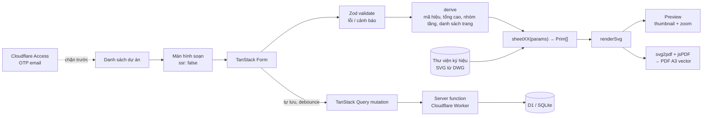

# Báo cáo giải pháp: Website tạo bản vẽ xây dựng thang máy theo thông số

> Bộ mẫu 1: `BV CT KHÁCH SẠN TƯ NHÂN CHÚ NGHIÊM - TP ĐÀ NẴNG.pdf` (9 trang A3)
> Bộ mẫu 2: `BV - CT NHÀ TƯ NHÂN Ô.KHẢI B.DIỄM - NHS - TP ĐN.pdf` + file `.dwg` gốc (AutoCAD 2007)
> Phiên bản 5, 21/10/2026: đã đọc được DWG; đã chốt 14 câu hỏi về quy tắc bản vẽ (mục 6).

## Tóm tắt

- **Mục tiêu:** web dùng riêng cho **1 người**. Bạn tạo **dự án**, điền form thông số, xem trước ngay bộ bản vẽ giống file mẫu (hình đúng tỷ lệ theo số liệu), rồi tải **PDF** về gửi cho khách. Dự án được lưu trên server để mở lại và sửa tiếp.
- **Đề xuất kỹ thuật:**
  - Framework **TanStack Start** (React + Vite), dùng TanStack Router, Form và Query.
  - Mỗi trang bản vẽ là một **component SVG có tham số**, khổ A3, đơn vị mm.
  - Xem trước và xuất PDF đều **chạy trên trình duyệt** (jsPDF + svg2pdf.js), nên server chỉ phải lưu và đọc dự án.
- **Hạ tầng rẻ nhất:**
  - **Cloudflare Workers** (chạy web và API) + **Cloudflare D1** (SQLite) qua Drizzle ORM.
  - Chặn người lạ bằng **Cloudflare Access** (miễn phí), chỉ cho **2 email** được phép vào. Không phải tự viết chức năng đăng nhập.
  - Chi phí vận hành: **0 USD/tháng**, dùng luôn địa chỉ `*.workers.dev` miễn phí.
- **Cách dựng hình (đã chốt):** vẽ bằng code theo thông số (SVG có tham số), kết hợp **thư viện ký hiệu lấy từ DWG gốc** (mục 3). Đã đọc thử DWG: render ra gần như y hệt PDF, lấy thẳng được 7 ký hiệu có sẵn.
- **Đối chiếu 2 bộ mẫu:** hai bộ có **cùng cấu trúc 9 trang và cùng bố cục**, chỉ khác số liệu và vài chi tiết. Điều này xác nhận cách dựng bằng tham số là phù hợp (mục 1.5).
- **Ước tính:** khoảng **36–51 người-ngày** (chưa tính dự phòng), tức khoảng **1,5–2,5 tháng cho 1 dev full-time**.

### Thông tin đã chốt

| Nội dung | Đã chốt | Ảnh hưởng tới giải pháp |
|---|---|---|
| DWG gốc | **Đã có và đã đọc được** file của bộ mẫu 2 (AutoCAD 2007), bằng LibreDWG + ezdxf | Lấy thư viện ký hiệu từ đây (mục 3.3, 3.4) |
| DTP 04 | **Chỉ là đánh số nhầm** (cả 2 bộ đều thiếu) | Web tự đánh số liền mạch: Bìa, DTP 01 → DTP 08 |
| Định dạng xuất | **Chỉ cần PDF** | Không làm xuất DXF/DWG |
| Người dùng | **1 người, dùng nội bộ, không phân quyền, có lưu theo dự án**; gửi khách bằng file PDF tải về | Cần backend + DB nhỏ; Cloudflare Access cho phép 2 email |
| Tên miền | **Không cần tên miền riêng** | Dùng `*.workers.dev` |
| Cách dựng hình | **SVG có tham số + thư viện ký hiệu lấy từ DWG** | Mục 3, ước tính ở mục 5 |
| Quy tắc bản vẽ | **Đã chốt 14 câu hỏi** (mục 6) | Form ở mục 2 và quy tắc dựng ở mục 3.5 đã cập nhật theo |
| Phạm vi MVP | **Chỉ kiểu thang như 2 bộ mẫu** | Thang hàng, cabin thông hai cửa, đối trọng đặt hông để sau |

---

## 1. Cấu trúc file PDF đầu ra (theo file mẫu)

### 1.1 Quy cách chung

| Hạng mục | Quy cách |
|---|---|
| Khổ giấy | A3 ngang, 420 × 297 mm (1191 × 842 pt) |
| Dạng nội dung | Vector (in A3 vẫn nét, chọn được chữ) |
| Font | Serif có đủ dấu tiếng Việt. Gợi ý **Tinos**: số đo chữ khớp Times New Roman, giống font trong bản gốc, giấy phép mở |
| Đơn vị vẽ | mm. Mỗi hình tự chọn tỷ lệ chuẩn (1:20, 1:25, 1:50, 1:100…) sao cho vừa vùng vẽ |
| Đánh số | Ký hiệu `DTP` + số thứ tự **liền mạch**, tự đánh lại khi thêm hoặc bớt trang |

### 1.2 Khung trang dùng chung (mọi trang trừ bìa)

| Vùng | Nội dung | Nguồn dữ liệu |
|---|---|---|
| Bảng hiệu chỉnh (trên cùng) | 8 cột: Chi tiết · Hiệu chỉnh · Ngày hiệu chỉnh · Lần hiệu chỉnh · Nhân viên hiệu chỉnh · Kiểm tra · Duyệt · Yêu cầu kỹ thuật | Form (danh sách hiệu chỉnh) |
| Loại hồ sơ | 6 ô tick: Tham khảo / Thiết kế cơ sở / **Trình duyệt** / Thi công / Hiệu chỉnh / Hoàn công | Form (chọn 1) |
| Thỏa thuận của chủ đầu tư | Ô trống để ký | Cố định |
| Logo + địa chỉ công ty | Logo, tên, địa chỉ, điện thoại | Cấu hình (không nằm trong form); logo dùng file SVG bạn sẽ gửi |
| Duyệt / Kiểm tra / Thiết kế | Tên người phụ trách | Form |
| Thông tin công trình | Tên công trình, địa chỉ (rút gọn), hạng mục ("THANG MÁY") | Form |
| Tên bản vẽ | Ví dụ "Mặt cắt ngang thang máy" | Cố định theo trang |
| Ký hiệu / số hiệu chỉnh / ngày | `DTP 03`, Revision no, Date | Tự đánh số + form |

### 1.3 Danh sách trang

*Trong báo cáo, các trang vẫn được gọi theo số của **file mẫu** để dễ đối chiếu. Cột "Số khi xuất" là số mà web sẽ in ra.*

| Trang mẫu | Số khi xuất | Tên bản vẽ | Loại nội dung | Thông số chính | Độ khó |
|---|---|---|---|---|---|
| Bìa | Bìa | Bản vẽ xây dựng thang máy | Chữ | Tên công trình, địa chỉ, hạng mục, tải trọng, số lượng, nơi/tháng phát hành | Thấp |
| DTP 01 | DTP 01 | Hạng mục trách nhiệm | Chữ có chèn số liệu | Dung sai 25/10 mm, khoan thử chống thấm 100 mm, CB 30 A, dây 3×10 mm², 1×8 mm², dư 3 m | Thấp |
| DTP 02 | DTP 02 | Đặc tính kỹ thuật | Bảng 12 dòng | Toàn bộ nhóm B ở mục 2 | Thấp |
| DTP 03 | DTP 03 | Mặt cắt ngang thang máy (mặt cắt cửa tầng) | Hình mặt bằng | AH×BH, tường 200, cabin CW×CD, ray, đối trọng, OP, lỗ chờ + hai bên, ghi chú xây chèn | Trung bình |
| DTP 05 | DTP 04 | Mặt cắt Pit hố thang (C-C) | Hình mặt đứng + mặt bằng pit | PIT, AH×BH, tường, ghi chú chống thấm | Thấp |
| DTP 06 | DTP 05 | Mặt cắt đứng hố thang | 2 hình mặt đứng + bảng chiều cao tầng + chi tiết móc palăng | Danh sách tầng, PIT, OH, buồng trên cùng, dầm kiềng, dầm đầu cửa, đà giữa tầng, cửa thô 2300 / HH 2100, máy kéo, giảm chấn | **Cao** |
| DTP 07 | DTP 06 | Chừa thô & hoàn thiện cửa tầng – bao che rộng (1F, JD320) | 2 mặt đứng + 2 mặt bằng | Lỗ chờ + hai bên, cao thô 2300, lanh tô 200, hộp nút 100×400 @1100, HH, OP | Trung bình |
| DTP 08 | DTP 07 | Như trên – bao che hẹp (35×50, các tầng còn lại) | Như 07 | Lỗ chờ + hai bên | Dùng lại component 07 |
| DTP 09 | DTP 08 | Mặt cắt ngang phòng máy (B-B) | Hình mặt bằng | AH×BH, tường, móc treo ở tâm hố, CPM, dầm đặt máy (nếu có) | Thấp |

Ghi chú về cách sinh trang:
- Trang cửa tầng (mẫu DTP 07/08) sinh **mỗi loại bao che một trang**, tùy theo những loại đang có trong danh sách tầng. Nếu mọi tầng đều dùng bao che hẹp thì chỉ còn một trang.
- Thứ tự trang khi xuất luôn cố định như bảng trên (đã chốt), dù PDF của bộ 2 đang xếp trang 06, 05, 03 lên trước.

### 1.4 Các điểm lệch nhau trong file mẫu và cách xử lý (đã chốt)

Khi mọi trang lấy số liệu từ cùng một bộ thông số, những lỗi dạng này sẽ không còn.

| Vấn đề | Bộ 1 (Chú Nghiêm) | Bộ 2 (Ô.Khải & B.Diễm) | Đã chốt |
|---|---|---|---|
| Ghi "không có phòng máy" (MRL) nhưng vẫn vẽ buồng trên cùng, CPM và chỗ đặt máy | Có ("PHÒNG KỸ THUẬT") | Có ("TẦNG MÁI") | Đúng chủ ý: **luôn vẽ** buồng trên cùng |
| CPM ở mặt cắt đứng khác ở mặt bằng phòng máy | 800×1500 so với 800×1200 | 800×1000 so với 800×1200 | **Một trường duy nhất**, mặc định 800×1200, in giống nhau ở cả 2 trang |
| Mã hiệu `CO60` dù tốc độ khác nhau | 90 m/ph | 60 m/ph | Không phải lỗi: mã hiệu **chỉ là mã thang**, không liên quan tốc độ, nên dùng ô chữ tự do |
| Tổng chiều cao hố | "-- mm" | "-- mm", dù đã có đủ chiều cao tầng (tính ra 20.900 mm) | **Tự tính** khi đã đủ chiều cao mọi tầng; thiếu thì in "-- mm" |
| Gộp tầng trên mặt cắt đứng | 1F · 2F · 3F~8F · 9F | 1F · 2F~3F · 4F · 5F | **Theo bộ 2** (quy tắc ở mục 3.5) |
| Tầng áp dụng bao che hẹp | Ghi 2F~8F (thiếu 9F) | Ghi 2F~5F (đủ) | Tự ghi đúng theo danh sách tầng |
| Đánh số trang | Thiếu DTP 04 | Thiếu DTP 04; thứ tự trang trong PDF bị đảo | Đánh số liền mạch, thứ tự trang cố định |
| Chính tả | "TRÁCH NHIÊM", "Đặt tính", "CARBIN" | Giống bộ 1 | Sửa luôn trong mẫu của web |

### 1.5 Đối chiếu bộ mẫu 2 với bộ mẫu 1

**Những phần giống nhau:**
- Cùng 9 trang, cùng bố cục và khung tên.
- Trang 01 (hạng mục trách nhiệm) giống **từng chữ**, kể cả CB 30 A và dây 3×10 mm², 1×8 mm².
- Các số sau giữ nguyên ở cả hai bộ:
  - Đà giữa tầng cách nhau 1500 ở tầng trên cùng, 1600 ở các tầng còn lại.
  - Cửa thô 2300 / HH 2100.
  - Hộp nút gọi 100×400, đáy cách sàn 1100.
  - Chi tiết móc palăng: thép Ø18, kích thước 200 / 1500.
  - Tường dày 200.

Cấu trúc bản vẽ ổn định như vậy, nên dựng hình bằng tham số là hợp lý.

**Những phần khác nhau và cách đưa vào form:**

| Thông số | Bộ 1 | Bộ 2 | Cách xử lý trong web |
|---|---|---|---|
| Tải trọng / hố / cabin / cửa | 750 kg; 1800×2000; 1400×1400; OP 800 | 550 kg; 1500×1900; 1100×1300; OP 700 | Có sẵn trong form |
| Số điểm dừng / tốc độ | 9 / 90 m/ph | 5 / 60 m/ph | Có sẵn trong form |
| Máy kéo / tủ điều khiển | MONTANARI / STEP | FUJI - THAILAND ĐỒNG BỘ | Ô chữ tự do |
| PIT / OH | 1500 / 5100 (3600 + 1500) | 1400 / 4800 (3600 + 1200) | Có sẵn trong form |
| Tên buồng trên cùng | PHÒNG KỸ THUẬT | TẦNG MÁI | **Thêm trường** |
| Dầm kiềng quanh hố | 200×300 ở mọi tầng | 200×300 ở mái, 200×400 ở các tầng | **Tách thành 2 trường** |
| Cách đỡ máy | "Sàn đặt máy 200×200" | "Vị trí đặt máy" + 3 "Dầm đặt máy" trên mặt bằng phòng máy | **Thêm ô chọn kiểu đỡ máy** |
| Móc treo trên mặt bằng phòng máy | Cách vách 900 / 1000 | Cách vách 750 / 950 | Cả hai đều đúng **tâm hố** (AH/2, BH/2), nên **tự tính** |
| Lỗ chờ cửa tầng | Rộng 1100 (hai bên 350); hẹp 1000 (hai bên 400) | Rộng 1100 (hai bên 200); hẹp 900 (hai bên 300) | Hẹp = OP + 200, rộng = 1100 → **tự tính** (đã chốt) |
| Ghi chú "Xây chèn sau khi lắp xong cửa" trên mặt cắt ngang | Không có | Có | **Thêm công tắc bật/tắt** |
| Kiểu ghi kích thước hố | "1800", "Lỗ chờ = 1000" | "Chiều rộng = 1500", "LỖ CHỜ = 900" | Dùng kiểu của bộ 2 (đã chốt) |
| Đường ngắt trên mặt cắt đứng | Không có | Có (giữa 4F và 2F~3F) | Tự vẽ khi có gộp tầng |
| Bảng chiều cao tầng | Để "……." | Có số: 5F 4800 · 3F-4F 3600 · 2F 3600 · 1F 3900 · PIT 1400 | Lấy từ danh sách tầng |
| Duyệt / Kiểm tra | Trống | Lê Duy Khánh / Nguyễn Văn Phú | Có sẵn trong form |
| Ngày hoàn thành | Chỉ có ở trang 06 | Có ở mọi trang | Mặc định điền ở mọi trang |
| Địa chỉ | TP ĐÀ NẴNG | Bìa ghi "HUỲNH VĂN NGHỆ - TP ĐÀ NẴNG", khung tên ghi "HUỲNH VĂN NGHỆ - TPĐN" | **Thêm trường địa chỉ rút gọn** cho khung tên |
| Hướng trang trong PDF | Ngang | Lưu dọc, xoay 270° khi xem | Web luôn xuất A3 ngang |

---

## 2. Thông số người dùng được chỉnh (form)

Mỗi dự án có một màn hình: **form ở bên trái** chia theo nhóm (accordion), **bản xem trước ở bên phải**. Không chỉnh trực tiếp trên bản vẽ. Dự án mới được tạo từ một trong **2 bộ mẫu** có sẵn: Khách sạn Chú Nghiêm hoặc Nhà Ô.Khải & B.Diễm. Cột "Mặc định" dưới đây ghi theo bộ 1; chỗ nào bộ 2 khác thì ghi thêm.

### A. Thông tin hồ sơ

| Trường | Mặc định | Dùng ở |
|---|---|---|
| Tên công trình | KHÁCH SẠN TƯ NHÂN CHÚ NGHIÊM | Bìa, khung tên, tên dự án |
| Địa chỉ đầy đủ | TP ĐÀ NẴNG (bộ 2: HUỲNH VĂN NGHỆ - TP ĐÀ NẴNG) | Bìa |
| Địa chỉ rút gọn (để trống thì dùng địa chỉ đầy đủ, tự co chữ cho vừa ô) | Trống (bộ 2: HUỲNH VĂN NGHỆ - TPĐN) | Khung tên |
| Hạng mục (tự gợi ý từ loại thang + tải trọng + số lượng, sửa được) | THANG TẢI KHÁCH - TẢI TRỌNG 750 KG - SỐ LƯỢNG : 1 THANG | Bìa |
| Số lượng thang | 1 | Bìa |
| Nơi & tháng phát hành | Đà Nẵng, 10/2026 | Bìa |
| Loại hồ sơ (radio, 6 lựa chọn) | Trình duyệt | Khung tên |
| Thiết kế / Kiểm tra / Duyệt | Trần Anh Vũ / – / – (bộ 2: Trần Anh Vũ / Nguyễn Văn Phú / Lê Duy Khánh) | Khung tên |
| Ngày hoàn thành, số hiệu chỉnh (điền cho mọi trang, ghi đè được từng trang) | – | Khung tên |
| Lịch sử hiệu chỉnh (danh sách 8 cột) | Trống | Bảng hiệu chỉnh |

*Logo, tên, địa chỉ, điện thoại công ty và tiền tố `DTP` đặt trong file cấu hình, không cho người dùng sửa trong form.*

### B. Đặc tính kỹ thuật

| Trường | Mặc định | Dùng ở |
|---|---|---|
| Loại thang (select) | Tải khách không phòng máy (MRL) | 02, bìa |
| Mã hiệu thang (ô chữ tự do, không tự sinh) | MRL - 750 - CO60 - 9/9 (bộ 2: MRL - 550 - CO60 - 5/5) | 02 |
| Tải trọng (kg) | 750 | 02, bìa, mã hiệu |
| Hố thang AH × BH (mm) | 1800 × 2000 | 02, 03, 05, 09 |
| Cabin CW × CD × CH | 1400 × 1400 × 2350 | 02, 03 |
| Cửa OP × HH, kiểu mở (CO mở giữa / 2S lùa một bên) | 800 × 2100, CO | 02, 03, 06, 07, 08 |
| Số điểm dừng / số cửa | 9 / 9 | 02, mã hiệu, sinh danh sách tầng |
| Tốc độ (m/phút) | 90 | 02, mã hiệu |
| Máy kéo / tủ điều khiển (ô chữ tự do) | MONTANARI / STEP | 02 |
| PIT / OH / chiều cao buồng trên cùng | 1500 / 3600 / 1500 | 02, 05, 06 |
| Nguồn điện chính / đèn | AC 380V 50Hz 3 Phase / AC 220V 50Hz 1 Phase | 02 |

### C. Kết cấu hố & cửa tầng

| Trường | Mặc định | Dùng ở |
|---|---|---|
| Chiều dày tường hố | 200 | 03, 05, 09 |
| Dầm kiềng ở mái / buồng trên cùng | 200 × 300 | 06 |
| Dầm kiềng ở các tầng | 200 × 300 (bộ 2: 200 × 400) | 06 |
| Dầm đầu cửa | 200 × 200 | 06 |
| Đà giữa tầng: tiết diện, khoảng cách | 200 × 200; 1500 (tầng trên cùng) / 1600 | 06 |
| Chiều cao lỗ chờ cửa thô / lanh tô | 2300 / 200 | 06, 07, 08 |
| Bề rộng lỗ chờ theo loại bao che (tự tính, chỉ hiển thị) | Rộng JD320: 1100 · Hẹp 35×50: OP + 200 | 03, 07, 08 |
| Hộp nút gọi: kích thước lỗ, cao độ đáy | 100 × 400, @1100 | 07, 08 |
| Ghi chú "Xây chèn sau khi lắp xong cửa" (bật/tắt) | Tắt (bộ 2: bật) | 03 |

### D. Danh sách tầng (dạng mảng, tự sinh theo số điểm dừng, sửa được từng dòng)

| Cột | Mặc định |
|---|---|
| Tên tầng | 1F … 9F (tầng trên cùng ghi "(OH)") |
| Chiều cao tầng (mm): dùng cho bảng chiều cao tầng và tổng chiều cao hố. Trên hình mặt cắt đứng **luôn ghi "THEO THỰC TẾ"** | Trống (bộ 2: 1F 3900, 2F–4F 3600) |
| Loại bao che | 1F: rộng · các tầng còn lại: hẹp |
| Có cửa tầng | Có |

### E. Buồng trên cùng / phòng máy / móc treo

| Trường | Mặc định | Dùng ở |
|---|---|---|
| Tên buồng trên cùng | PHÒNG KỸ THUẬT (bộ 2: TẦNG MÁI) | 06 |
| Cửa phòng máy CPM (W × H), in giống nhau ở cả 2 trang | 800 × 1200 | 06, 09 |
| Kiểu đỡ máy | Sàn đặt máy 200 × 200 (bộ 2: dầm đặt máy 3 phía) | 06, 09 |
| Móc treo: tải trọng | 2 tấn | 06, 09 |
| Móc treo: vị trí | Tự tính ở tâm hố (AH/2, BH/2), sửa được | 09 |
| Chi tiết móc palăng: đường kính thép, kích thước | Ø18, 200, 1500 | 06 |

### F. Hạng mục trách nhiệm

| Trường | Mặc định |
|---|---|
| Sai lệch bề rộng (mỗi bên) / sai lệch trục đứng | +25 mm / 10 mm |
| Độ sâu khoan thử chống thấm pit | 100 mm |
| CB tổng / dây động lực / dây trung hòa / chiều dài dây dư | 30 A / 3 × 10 mm² / 1 × 8 mm² / 3 m |
| Ghi chú thêm (textarea, in cuối trang 01) | Trống |

### Trường tự tính (chỉ đọc, hiển thị trong form)

| Trường | Công thức / quy tắc |
|---|---|
| Tổng chiều cao hố | PIT + Σ chiều cao tầng + OH, khi đã nhập đủ chiều cao mọi tầng; thiếu thì in "-- mm". Bộ 2 ra 1400 + 3900 + 3×3600 + 4800 = 20.900 mm |
| Lỗ chờ + bề rộng hai bên | Bao che hẹp: OP + 200; bao che rộng: 1100. Mỗi bên = (AH − lỗ chờ) / 2, ví dụ (1500 − 900) / 2 = 300 |
| Vị trí móc treo | Tâm hố (AH/2, BH/2), sửa tay được |
| Nhóm tầng hiển thị | Theo bộ 2 (mục 3.5) |
| Danh sách trang + số hiệu | Theo các loại bao che đang dùng |

### Luật kiểm tra (Zod; chia hai mức **lỗi** chặn xuất file và **cảnh báo** vẫn cho xuất)

- CW + khe ray ≤ AH; CD + khoảng đối trọng/ngưỡng cửa ≤ BH. Khe tối thiểu cấu hình được; cả hai bộ mẫu đều có AH − CW = 400 và BH − CD = 600.
- OP ≤ lỗ chờ ≤ AH − 2 × bề rộng tường tối thiểu; HH < chiều cao lỗ chờ thô.
- PIT/OH tối thiểu theo tốc độ: là bảng tra cấu hình được, dùng TCVN 6395 và TCVN 7628 làm tham khảo. **Kỹ sư cần xác nhận số liệu trước khi dùng.**
- Số dòng của danh sách tầng phải bằng số điểm dừng.

**Tiện ích đi kèm:**
- **Tự lưu** vào dự án trên server, sau mỗi lần ngừng gõ khoảng 1–2 giây.
- Nút **"Lưu phiên bản"**: chụp lại thông số hiện tại kèm ghi chú. Danh sách phiên bản có thể dùng để điền bảng hiệu chỉnh.
- **Xuất/nhập JSON** để sao lưu hoặc chuyển dự án sang máy khác.

---

## 3. Cách dựng hình theo thông số (đã chốt)

Có hai phần đi cùng nhau:
- **Vẽ bằng code (SVG có tham số):** những gì thay đổi theo số liệu như tường, lỗ mở, dầm, cao độ tầng, kích thước và ghi chú đều do code tính và vẽ.
- **Thư viện ký hiệu lấy từ DWG gốc:** những chi tiết phức tạp nhưng ít đổi hình dạng như máy kéo, ray, giảm chấn, cánh cửa được lấy nguyên từ DWG **một lần**. Sau đó code chỉ việc đặt vào đúng vị trí.

Kết quả là hình đúng tỷ lệ theo số liệu, xem trước cập nhật ngay khi gõ, nét vẽ gần với bản AutoCAD, và không tốn server.

### 3.1 Nguyên lý

```
thông số (form) → derive (trường tự tính) → sheetXX(params) → Prim[] → renderSvg → xem trước / PDF
```

Mỗi hàm `sheetXX` là logic thuần: nhận thông số, trả về danh sách phần tử hình học (`Prim`), không đụng tới giao diện. Nhờ vậy viết unit test dễ, và xem trước với PDF luôn ra cùng một hình.

```ts
type Prim =
  | { kind: 'line';   a: Pt; b: Pt; layer: Layer }
  | { kind: 'region'; outline: Pt[]; hatch?: 'brick' | 'concrete' }
  | { kind: 'dim';    a: Pt; b: Pt; offset: number; text?: string }   // text: "Chiều rộng = 1500"…
  | { kind: 'leader'; from: Pt; to: Pt; text: string }
  | { kind: 'text';   at: Pt; value: string; size: number }
  | { kind: 'break';  a: Pt; b: Pt }                                     // đường ngắt khi gộp tầng
  | { kind: 'symbol'; id: SymbolId; at: Pt; scale: number; stretch?: { x?: number; y?: number } }

const sheetPlan = (p: ElevatorParams): Prim[] => [...]   // mặt cắt ngang
```

### 3.2 Phần vẽ bằng code

Một bộ phần tử cơ bản dùng chung cho mọi trang:

| Phần tử | Dùng để vẽ |
|---|---|
| `Dimension` | Đường kích thước: đường gióng, gạch chéo hoặc mũi tên, chữ. Chữ ghi theo kiểu bộ 2, ví dụ "Chiều rộng = 1500", "LỖ CHỜ = 900" |
| `HatchRegion` | Tường gạch, bê tông chấm. Hatch được sinh thành nét vẽ thật và cắt theo `clipPath`, không dùng `<pattern>`, để svg2pdf xử lý ổn định |
| `Leader` | Ghi chú có đường dẫn, ví dụ "*Dầm bê tông 200×300 kiềng quanh hố thang" |
| `BreakLine` | Đường ngắt ở chỗ gộp tầng |
| `DoorArrow`, `SectionMark` | Mũi tên "Hướng cửa vào thang máy", ký hiệu mặt cắt A/B/C |
| `Table` | Bảng chiều cao tầng, bảng đặc tính |
| `fitScale` | Chọn tỷ lệ chuẩn lớn nhất mà hình vẫn vừa vùng vẽ |

### 3.3 Thư viện ký hiệu (lấy từ DWG)

Kết quả đọc DWG cho thấy ký hiệu nằm ở 3 dạng:
- ✅ **Có sẵn thành block:** xuất thẳng ra SVG.
- ⚠️ **Nét rời trong hình của trang:** phải cắt theo vùng rồi dọn tay.
- ❌ **Không lấy được.**

| Ký hiệu | Dùng ở trang | Trong DWG | Cách đặt vào hình |
|---|---|---|---|
| Cụm cabin nhìn hông (khung, cabin, guide shoe, ngưỡng) | 06 | ✅ block `5` (1186 × 3932 mm) | Đặt ở tầng trên cùng |
| Cánh cửa tầng nhìn hông + khóa cửa | 06 | ✅ block `89` (dùng 4 lần) | Đặt ở mỗi tầng có cửa |
| Máy kéo | 06 | ✅ block `GTW7-41P0-a` (662 × 503 mm) | Đặt trong buồng trên cùng; MVP dùng ký hiệu này cho mọi hãng máy |
| Cụm ty cáp có lò xo | 06 | ✅ block `WWWWWW` | Đặt trên đỉnh cabin |
| Giảm chấn (2 loại) | 06 | ✅ block `F`, `U` | Đặt ở đáy pit |
| Thang xuống pit | 06 | ✅ block `56` | Đặt ở đáy pit |
| Ray T, khung đối trọng (mặt bằng) | 03 | ⚠️ nét rời | Ray đặt sát vách hông; đối trọng đặt sát vách sau, kéo giãn theo chiều ngang |
| Cánh cửa + ngưỡng cửa trên mặt bằng | 03, 07, 08 | ⚠️ nét rời | Kéo giãn theo OP |
| Cánh cửa nhìn trước, khung bao che rộng JD320 / hẹp 35×50 | 06, 07, 08 | ⚠️ nét rời | Kéo giãn theo OP và HH; khung bám theo mép lỗ chờ |
| Hộp nút gọi, hộp hiển thị tầng | 06, 07, 08 | ⚠️ nét rời | Đặt theo cao độ 1100 |
| Móc treo (mặt bằng), chi tiết móc palăng Ø18 | 06, 09 | ⚠️ nét rời | Móc đặt ở tâm hố; chi tiết móc giữ nguyên |
| Logo công ty | Bìa, khung tên | ❌ là đối tượng OLE (ảnh dán từ ứng dụng khác), không lấy ra được | Dùng file SVG bạn sẽ gửi |

Mỗi ký hiệu có **điểm chèn** (gốc tọa độ) và các trục cho phép kéo giãn, đặt tên theo quy ước, ví dụ `door-co`, `rail-t`, `buffer`.

### 3.4 Quy trình lấy ký hiệu từ DWG (đã chạy thử ngày 21/10/2026)

Việc này **chỉ làm một lần, trên máy của dev**. Không có gì phải chạy trên server, nên hosting vẫn 0 USD.

1. **Đổi DWG sang DXF** bằng `dwg2dxf` của LibreDWG 0.14 (mã nguồn mở, cài qua Homebrew).
   - File AutoCAD 2007 đổi xong trong khoảng 1,5 giây, ra DXF 29 MB.
   - Chỉ có cảnh báo về `DIMASSOC` (liên kết giữa đường kích thước và hình), không ảnh hưởng tới hình.
2. **Đọc bằng `ezdxf`.** Có 4 lỗi nhỏ, thư viện tự sửa được. Render thử trang mặt cắt đứng và trang phòng máy ra ảnh thì **gần như y hệt PDF**.
3. **Chạy script Python để lấy ký hiệu:**
   - Block có sẵn thì xuất thẳng ra SVG.
   - Ký hiệu ở dạng nét rời thì chọn theo vùng trong hình của trang, rồi xuất ra SVG.
   - Đặt lại gốc tọa độ cho từng ký hiệu.
4. **Dọn và đặt tên** các file SVG, lưu vào `src/drawing/symbols/`, rồi so bằng mắt với PDF mẫu.
5. Khi DWG mẫu được cập nhật thì chạy lại script.

**Những điều biết được về file DWG:**
- **Cách sắp trang:** 9 trang nằm cạnh nhau trong Model (Layout1 để trống). Mỗi trang là một khung A3 được phóng to.
- **Hình của các trang vẽ tỷ lệ 1:1 theo mm**, nằm trong một block riêng cho mỗi trang, rồi chèn vào khung với hệ số khoảng 17–23:

  | Block | Trang |
  |---|---|
  | `M7` | Mặt cắt đứng |
  | `M6` | Cửa tầng bao che rộng |
  | `M5` | Cửa tầng bao che hẹp |
  | `M2` | Pit |
  | `1.` | Mặt cắt ngang |
  | `1..` | Phòng máy |

  Các trang chữ (bìa, 01, 02) vẽ trực tiếp. Vì số đo trong các block là mm thật, có thể dùng luôn để đối chiếu kết quả của hàm vẽ.
- **Đơn vị:** phần header khai báo là inch, nhưng thực tế vẽ bằng mm. Script bỏ qua khai báo này.
- **Layer:** file có sẵn nhiều layer đặt tên rõ ràng (`Tuong`, `Ray`, `Doi trong`, `Bao che`…), nhưng gần như mọi nét lại nằm trên layer `KT` và `0`. Vì vậy không dựa vào layer để phân loại được, và độ dày nét sẽ do web tự quy định.
- **Font và chữ:**
  - Chủ yếu dùng Times New Roman, vài kiểu chữ dùng font VNI và SHX. Chữ lưu dạng Unicode nên đọc được.
  - Vài chữ có dấu ở trang 01 bị lỗi mã khi chuyển đổi, do đoạn chữ đó khai báo bảng mã khác. Script sửa được, và nội dung trang 01 dù sao cũng lấy từ PDF.
- **Logo** là đối tượng OLE nên không lấy ra được, cần file ảnh riêng.
- **Bản sao thừa:** góc dưới Model còn một bản sao nhỏ của các hình, có lẽ là bản nháp. Script bỏ qua phần này.

### 3.5 Quy tắc dựng từng trang

| Trang mẫu | Cách dựng |
|---|---|
| 03 Mặt cắt ngang | Vẽ hố AH×BH và tường 200, cột bê tông ở 4 góc. Cabin CW×CD canh giữa theo chiều ngang; ray hai bên; đối trọng ở vách sau; cửa và ngưỡng ở vách trước. Lỗ chờ có kích thước hai bên. Có thể bật ghi chú "Xây chèn sau…" theo từng dự án |
| 05 Pit | Mặt cắt đứng pit theo chiều sâu PIT, mặt bằng pit AH×BH, ghi chú chống thấm |
| 06 Mặt cắt đứng | **Gộp tầng theo bộ 2.** Với N tầng, vẽ 1F · nhóm 2F~(N−2) · tầng N−1 · tầng N (OH), có đường ngắt ở chỗ gộp. Nếu N ≤ 4 thì vẽ đủ từng tầng, không gộp. **Cao độ các tầng trên hình luôn ghi "THEO THỰC TẾ".** Mỗi mức gồm sàn, dầm kiềng, dầm đầu cửa, lỗ chờ 2300 / HH 2100, đà giữa tầng. Trên cùng **luôn vẽ** buồng trên cùng (tên lấy từ form), CPM, móc treo, máy kéo và kiểu đỡ máy. Dưới cùng là pit với giảm chấn. Bên phải là bảng chiều cao tầng (gộp dòng giống hình, tầng trong nhóm cao khác nhau thì tách dòng; in số nếu đã nhập, trống thì in "…….") và chi tiết móc palăng. Vẽ 2 hình: nhìn hông (BH) và nhìn trước (AH) |
| 07/08 Cửa tầng | Một component, mỗi loại bao che một trang. Gồm mặt đứng chừa thô, mặt đứng hoàn thiện, và 2 mặt bằng tương ứng. Lỗ chờ, hai bên, hộp nút, HH, OP lấy theo thông số |
| 09 Phòng máy | Vẽ hố và tường, CPM ở vách trước (cùng giá trị với trang 06), móc treo ở tâm hố có kích thước định vị. Nếu chọn kiểu "dầm đặt máy" thì vẽ thêm dầm ở 3 phía |

### 3.6 Kiểm soát chất lượng

- **2 bộ mẫu làm "ảnh chuẩn":** nạp thông số của từng bộ, xuất PDF, rồi dùng Playwright so ảnh từng trang với PDF gốc. Sai lệch phải nằm trong ngưỡng chấp nhận.
- **Unit test cho các hàm `sheetXX` và luật tính**, ví dụ lỗ chờ, móc ở tâm hố, cách gộp tầng (thử với N = 3, 4, 5, 9 và 20 tầng).
- **Giới hạn:** nét vẽ không giống AutoCAD 100% (độ dày nét, font). Có thể chấp nhận được vì số liệu và tỷ lệ luôn đúng.

---

## 4. Tech stack, deploy & database (không dùng Next.js, chi phí thấp nhất)

### 4.1 Thư viện

| Hạng mục | Lựa chọn | Ghi chú |
|---|---|---|
| Framework | **TanStack Start** (React + Vite + TypeScript) | Cần lưu dự án nên dùng full-stack, nhưng gọn: chỉ vài **server function** đọc/ghi dự án, bên dưới vẫn là TanStack Router |
| SSR | Selective SSR: tắt SSR (`ssr: false`) ở màn hình soạn bản vẽ | Màn hình này nặng và chỉ chạy ở trình duyệt. Tắt SSR giúp server gần như không tốn CPU (gói miễn phí giới hạn 10 ms CPU mỗi request) |
| Form | **TanStack Form** + **Zod** (Standard Schema) | Hỗ trợ trường dạng mảng (danh sách tầng, lịch sử hiệu chỉnh); kiểm tra từng trường và chéo giữa các trường |
| Dữ liệu server | **TanStack Query** | Danh sách dự án, tải dự án, tự lưu (mutation + debounce), cập nhật lạc quan (optimistic) |
| ORM / migration | **Drizzle ORM** (`drizzle-orm/d1`) + drizzle-kit | Schema viết bằng TypeScript, có kiểu; migration chạy bằng `wrangler d1 migrations` |
| UI | Tailwind CSS v4 + shadcn/ui | shadcn có sẵn ví dụ dùng với TanStack Form |
| Xem trước | SVG trực tiếp + `react-zoom-pan-pinch` | Cột thumbnail các trang + vùng phóng to; `useDeferredValue` để gõ không giật |
| Xuất PDF | **jsPDF + svg2pdf.js** (chạy trên trình duyệt) | Chuyển đúng các SVG đang xem sang PDF vector; nhúng font Tinos (TTF) cho tiếng Việt. **Không lưu file PDF**: mở dự án là sinh lại được bất cứ lúc nào |
| Công cụ lấy ký hiệu (chỉ dùng khi phát triển) | LibreDWG (`dwg2dxf`) + Python `ezdxf` | Chạy trên máy dev để đổi DWG sang DXF rồi chuyển ký hiệu sang SVG (mục 3.4) |
| Kiểm thử | Vitest (luật tính, hàm vẽ) + Playwright (so ảnh từng trang) | Dùng 2 bộ mẫu làm ảnh chuẩn |

**Vì sao không chọn `@react-pdf/renderer`:** phần SVG nó hỗ trợ khá hạn chế (không có `<pattern>`, `<use>`/`<symbol>`). Ngoài ra, xem trước bằng cách render lại cả file PDF sau mỗi lần gõ thì chậm và nháy màn hình.

### 4.2 Deploy & database: 0 USD/tháng

Toàn bộ chạy trên **Cloudflare** (tài khoản miễn phí):

| Thành phần | Dịch vụ | Hạn mức gói miễn phí | Chi phí |
|---|---|---|---|
| Web + API (server function) | **Cloudflare Workers**, deploy bằng `@cloudflare/vite-plugin` (cách deploy chính thức trong tài liệu TanStack Start) | 100.000 request/ngày; 10 ms CPU mỗi request; file tĩnh (JS, font, logo) miễn phí, không giới hạn | 0 USD |
| Database | **Cloudflare D1** (SQLite) | 5 GB tổng; mỗi DB tối đa 500 MB; 5 triệu dòng đọc/ngày; 100.000 dòng ghi/ngày; **Time Travel** khôi phục về thời điểm bất kỳ trong 7 ngày gần nhất | 0 USD |
| Chặn truy cập | **Cloudflare Access** (Zero Trust Free), bật bằng một cú nhấp trên Worker | Miễn phí tới 50 người dùng (ở đây dùng 2 email); đăng nhập bằng mã OTP gửi về email được phép | 0 USD |
| Tên miền | Dùng luôn `ten-app.<account>.workers.dev` | — | 0 USD |
| **Tổng** | | | **0 USD/tháng** |

**Vì sao vừa với gói miễn phí:**
- Thông số của một dự án dạng JSON chỉ khoảng 5–10 KB. 500 MB chứa được hàng chục nghìn dự án, kể cả khi mỗi dự án lưu nhiều phiên bản.
- Mỗi lần tự lưu chỉ ghi 1–2 dòng, nên 100.000 dòng ghi/ngày là quá dư cho 1 người dùng.
- Việc nặng nhất (vẽ hình, xuất PDF) chạy trên máy người dùng. Server chỉ đọc/ghi JSON, mất vài ms CPU mỗi request, nằm trong giới hạn 10 ms.

**Nếu lỡ vượt gói miễn phí** (khó xảy ra với 1 người dùng): chuyển sang Workers Paid, **5 USD/tháng**. Gói này gồm 10 triệu request/tháng, D1 tối đa 10 GB mỗi DB, và Time Travel 30 ngày. Code không phải sửa gì.

**Không cần tự làm đăng nhập:** danh sách của Cloudflare Access chỉ có 2 email được phép. Muốn thêm hoặc đổi email thì sửa trong dashboard Cloudflare, không phải sửa code. Người lạ có biết địa chỉ web cũng không mở được, nên thông tin khách hàng trong các dự án vẫn được bảo vệ.

**Sao lưu:**
- D1 Time Travel (7 ngày) để khôi phục khi lỡ tay.
- `wrangler d1 export` để tải toàn bộ DB về định kỳ.
- Nút "Xuất JSON" trên từng dự án.

### 4.3 Mô hình dữ liệu (D1 / SQLite)

```ts
// src/server/db/schema.ts (Drizzle)
projects = sqliteTable('projects', {
  id:            text('id').primaryKey(),             // nanoid
  name:          text('name').notNull(),              // mặc định = tên công trình
  params:        text('params', { mode: 'json' }).notNull(), // toàn bộ form
  schemaVersion: integer('schema_version').notNull(), // để migrate thông số khi form đổi
  createdAt:     integer('created_at', { mode: 'timestamp' }).notNull(),
  updatedAt:     integer('updated_at', { mode: 'timestamp' }).notNull(),
  deletedAt:     integer('deleted_at', { mode: 'timestamp' }), // xóa mềm
})

projectVersions = sqliteTable('project_versions', {
  id:        text('id').primaryKey(),
  projectId: text('project_id').notNull().references(() => projects.id),
  params:    text('params', { mode: 'json' }).notNull(),
  note:      text('note'),                            // dùng làm "nội dung hiệu chỉnh"
  createdAt: integer('created_at', { mode: 'timestamp' }).notNull(),
})
```

Thông số được lưu nguyên dạng JSON, không tách thành cột riêng. Nhờ vậy khi thêm hoặc bớt trường trong form thì không phải sửa database. Mỗi lần schema của form thay đổi, chỉ cần viết một hàm migrate theo `schemaVersion`.

### 4.4 Các lựa chọn rẻ khác (để so sánh)

| Phương án | Chi phí | Nhược điểm |
|---|---|---|
| Netlify / Vercel (free) + **Supabase** free (Postgres) | 0 USD | Supabase free **tự tạm dừng dự án sau 7 ngày không hoạt động**, không hợp với công cụ nội bộ dùng thưa; phải tự làm phần chặn truy cập |
| Netlify / Vercel (free) + Neon / Turso (free) | 0 USD | Phải dùng 2–3 nhà cung cấp; DB có thể khởi động chậm ở lần gọi đầu; vẫn phải tự chặn truy cập |
| VPS nhỏ (Hetzner, DigitalOcean…) + Docker + SQLite | Từ khoảng 4–6 USD/tháng | Tự lo cập nhật hệ điều hành, bảo mật, HTTPS, backup |

### 4.5 Luồng dữ liệu



### 4.6 Cây thư mục gợi ý

```
src/
  routes/                   # TanStack Router (file-based)
    __root.tsx
    index.tsx               # danh sách dự án: tạo từ bộ mẫu, nhân bản, đổi tên, xóa
    projects.$id.tsx        # form + preview (ssr: false)
  server/
    db/schema.ts            # Drizzle schema
    projects.ts             # createServerFn: list / get / save / saveVersion / remove
  domain/
    schema.ts               # Zod schema + migrate(schemaVersion)
    presets/                # chu-nghiem.ts, o-khai-b-diem.ts (2 bộ mẫu)
    derive.ts               # trường tự tính, nhóm tầng, danh sách trang
    rules.ts                # luật lỗi / cảnh báo
  drawing/
    primitives/             # Dimension, HatchRegion, Leader, BreakLine, Table, fitScale
    symbols/                # SVG <symbol> lấy từ DWG gốc
    sheets/                 # Cover, Responsibility, Spec, Plan, Pit, Section, LandingDoor, MachineRoom
    frame/                  # khung trang A3, bảng hiệu chỉnh, khung tên
  pdf/
    exportPdf.ts            # jsPDF + svg2pdf, đăng ký font
    fonts/Tinos-*.ttf
  config/company.ts         # logo, tên, địa chỉ công ty
tools/extract-symbols/      # script Python ezdxf: DWG/DXF → SVG (chỉ chạy trên máy dev)
drizzle/                    # file migration
wrangler.jsonc              # binding D1, cấu hình Worker
```

---

## 5. Ước tính thời gian

Giả định: 1 dev đã quen React/TanStack; đã đọc được DWG gốc (mục 3.4); quy tắc bản vẽ đã chốt (mục 6); MVP chỉ làm kiểu thang như 2 bộ mẫu; đơn vị là **người-ngày** (8 giờ), **chưa tính dự phòng**.

### 5.1 Phần nền

| Việc | Ngày |
|---|---|
| Khởi tạo dự án (TanStack Start + Cloudflare vite plugin, Tailwind, shadcn, lint, CI deploy) | 1–1.5 |
| Mô hình dữ liệu: Zod schema, 2 bộ mẫu, trường tự tính, luật kiểm tra | 2–3 |
| Form UI: 6 nhóm, danh sách tầng, lịch sử hiệu chỉnh, nhập/xuất JSON | 3–4 |
| **Lưu theo dự án**: D1 + Drizzle + migration, server function CRUD, trang danh sách dự án, tự lưu, phiên bản | 3–4 |
| Khung trang A3 + bảng hiệu chỉnh + khung tên (SVG) | 2–2.5 |
| Trang chữ: Bìa, DTP 01, DTP 02 | 1.5–2 |
| Giao diện xem trước: thumbnail, zoom/pan, chuyển trang | 1.5–2 |
| Xuất PDF vector + nhúng font tiếng Việt + đặt tên file | 1.5–2 |
| Kiểm thử, so ảnh với 2 bộ mẫu, sửa lỗi | 2–3 |
| Deploy Cloudflare + bật Access + kịch bản sao lưu | 0.5–1 |
| **Cộng** | **≈ 18–25** |

### 5.2 Phần dựng hình

| Việc | Ngày |
|---|---|
| Các phần tử cơ bản: kích thước, hatch, leader, đường ngắt, bảng, tự chọn tỷ lệ | 3–4 |
| Script lấy ký hiệu từ DWG: 7 block xuất thẳng, khoảng 6 nhóm ký hiệu phải cắt từ nét rời; dọn và đặt tên SVG | 3–4 |
| Mặt cắt ngang cửa tầng (mẫu DTP 03) | 2–3 |
| Pit (mẫu DTP 05) | 1–1.5 |
| Phòng máy (mẫu DTP 09) | 1–1.5 |
| Cửa tầng (mẫu DTP 07/08; một component, hai loại bao che) | 2–3 |
| Mặt cắt đứng (mẫu DTP 06: 2 hình, gộp tầng + đường ngắt, dầm/đà, ghi chú, bảng chiều cao, chi tiết móc) | 5–7 |
| Các biến thể thấy ở bộ 2: kiểu đỡ máy, ghi chú xây chèn, bảng chiều cao có số, địa chỉ rút gọn | 1–2 |
| **Cộng** | **≈ 18–26** |

### 5.3 Tổng

| Hạng mục | Người-ngày |
|---|---|
| Phần nền | 18–25 |
| Phần dựng hình | 18–26 |
| **Tổng chưa dự phòng** | **36–51 (khoảng 7–10 tuần)** |
| Dự phòng rủi ro 15–20% | **41–61 (khoảng 8–12 tuần)** |
| Chi phí vận hành | **0 USD/tháng** |

*Ngoài MVP: thêm loại thang khác (thang hàng, cabin thông hai cửa, đối trọng đặt hông) tốn thêm 3–6 ngày cho mỗi loại.*

### 5.4 Lộ trình theo giai đoạn

| Giai đoạn | Nội dung | Thời gian | Kết quả |
|---|---|---|---|
| GĐ0 | Đọc thử DWG, chốt quy tắc bản vẽ | **Đã xong** (21/10/2026) | Quy tắc và giá trị mặc định đã được xác nhận; chỉ còn chờ file logo SVG |
| GĐ1 | Phần nền (mục 5.1) | 18–25 ngày (~4–5 tuần) | Đã dùng được trên Cloudflare: danh sách dự án → form → tự lưu → xem trước → tải PDF gồm bìa, DTP 01, DTP 02 |
| GĐ2 | Phần tử cơ bản + ký hiệu từ DWG + mặt cắt ngang, pit, phòng máy | 10–14 ngày (~2–3 tuần) | Có các hình mặt bằng và pit |
| GĐ3 | Cửa tầng + mặt cắt đứng + các biến thể của bộ 2 | 8–12 ngày (~1.5–2.5 tuần) | Đủ bộ 9 trang, khớp với cả 2 bộ mẫu |

---

## 6. Câu hỏi đã chốt và việc còn chờ

### 6.1 Đã chốt (21/10/2026)

| # | Nội dung | Đã chốt |
|---|---|---|
| 1 | Buồng trên cùng (phòng kỹ thuật / tầng mái) | **Luôn vẽ**; tên buồng là ô chữ |
| 2 | Cửa phòng máy CPM | **Một trường duy nhất**, mặc định 800×1200, in giống nhau ở trang mặt cắt đứng và trang phòng máy |
| 3 | Mã hiệu thang | **Chỉ là mã thang**, không liên quan tốc độ, nên dùng ô chữ tự do |
| 4 | Tổng chiều cao hố | Tự tính PIT + Σ chiều cao tầng + OH khi đã nhập đủ; thiếu thì in "-- mm" |
| 5 | Cao độ tầng trên mặt cắt đứng | **Luôn ghi "THEO THỰC TẾ"**; số thật chỉ in trong bảng chiều cao tầng |
| 6 | Gộp tầng trên mặt cắt đứng | **Theo bộ 2**: 1F · 2F~(N−2) · N−1 · N(OH); vẽ đủ từng tầng khi N ≤ 4 |
| 7 | Lỗ chờ cửa tầng | **Tự tính**: hẹp = OP + 200, rộng = 1100; 1F mặc định bao che rộng |
| 8 | Dầm kiềng | 2 trường riêng: ở mái / buồng trên cùng và ở các tầng |
| 9 | Đỡ máy | Ô chọn: sàn đặt máy hoặc dầm đặt máy 3 phía; MVP dùng một ký hiệu máy chung |
| 10 | Móc treo | Tự tính ở tâm hố, sửa tay được |
| 11 | Trình bày | Ghi kích thước theo kiểu bộ 2; ghi chú "Xây chèn sau khi lắp xong cửa" bật/tắt theo dự án; thứ tự trang cố định |
| 12 | Logo | Bạn sẽ gửi file SVG |
| 13 | Loại thang khác (thang hàng, cabin thông hai cửa, đối trọng đặt hông) | Chưa làm trong MVP |
| 14 | Gộp dòng trong bảng chiều cao tầng | **Gộp giống hình** (với bộ 2 là 1F · 2F~3F · 4F · 5F); các tầng trong nhóm cao khác nhau thì tách thành từng dòng |

### 6.2 Việc còn chờ

| # | Việc | Ghi chú |
|---|---|---|
| 12 | **File logo SVG** (kèm tên, địa chỉ, điện thoại công ty nếu khác bản vẽ hiện tại) | Cần trước khi hoàn thiện khung trang ở GĐ1. Trong lúc chờ sẽ dùng logo tạm |
