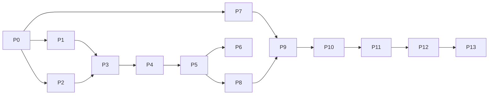

# Super plan — Web tạo bản vẽ xây dựng thang máy

> **Nguồn:** [`docs/bao-cao-giai-phap-web-ban-ve-thang-may.md`](bao-cao-giai-phap-web-ban-ve-thang-may.md) (báo cáo v5, 21/10/2026). Mọi quyết định nghiệp vụ lấy từ báo cáo, đặc biệt là mục 6.
> **Lập ngày:** 21/10/2026, dựa trên dự án vừa khởi tạo (TanStack Start + Cloudflare + Drizzle + shadcn).
> **Cách dùng:** mỗi bước có ô `[ ]`, làm xong thì đánh `[x]`. Mỗi phase có **tiêu chí xong**. Chỉ chuyển phase khi tiêu chí xong đã đạt.

---

## 0. Tóm tắt

| Hạng mục | Nội dung |
|---|---|
| **Sản phẩm** | Web nội bộ cho 1 người dùng. Người dùng tạo **dự án**, điền form thông số thang máy, xem trước ngay bộ bản vẽ A3 (9 trang như file mẫu), rồi tải **PDF** về gửi khách. Dự án được lưu trên server. |
| **Phạm vi MVP** | Chỉ kiểu thang giống 2 bộ mẫu (Chú Nghiêm, Ô.Khải & B.Diễm). Chỉ xuất PDF. |
| **Dựng hình** | SVG có tham số (hàm thuần `params → Prim[]`), kết hợp thư viện ký hiệu lấy từ DWG. Xem trước và PDF dùng chung một SVG. |
| **Stack** | TanStack Start (Router, Form, Query) · Zod 4 · Drizzle + Cloudflare D1 · Cloudflare Workers · Tailwind v4 + shadcn/ui · jsPDF + svg2pdf.js · Vitest + Playwright. Trình quản lý gói: **yarn 1**. |
| **Giao diện** | **Hallmark · Cobalt**, đổi màu theo logo DTP. Font giao diện **Be Vietnam Pro** + **JetBrains Mono**. Xem mục 3. |
| **Logo** | **DTP** in trên bản vẽ (bìa + khung tên). **DTP** cũng dùng cho giao diện web (masthead trang `/`, favicon) — đổi từ E-TECH sau review P1. Tất cả chuyển sang **WebP**. |
| **Hạ tầng** | Workers + D1 + Cloudflare Access trên tài khoản Cloudflare cá nhân của người phát triển (chủ repo; danh sách email được vào do chủ tài khoản quản lý), địa chỉ `*.workers.dev`. **0 USD/tháng**; nếu vượt gói free thì gửi bill cho PO. |
| **Ước tính** | **38–54 người-ngày** chưa tính dự phòng; cộng dự phòng 15–20% thì khoảng **44–65 ngày (9–13 tuần)**. So với báo cáo, tăng thêm 2–3 ngày cho phần hệ thống giao diện Hallmark. |

### Quy ước làm việc

- **Trình quản lý gói:** chỉ dùng **yarn 1.22**. Không commit `package-lock.json` hay `pnpm-lock.yaml`. Thêm component shadcn bằng `npx shadcn@latest add <tên>`; CLI tự nhận yarn qua `yarn.lock`.
- **Import:** dùng alias `#/` trỏ vào `src/`, ví dụ `import { cn } from '#/lib/utils'`.
- **Tên file:** viết kiểu kebab-case cho giống code sẵn có, ví dụ `render-svg.tsx`, `export-pdf.ts`. Báo cáo ghi `exportPdf.ts`, nhưng plan này theo quy ước của code.
- **Ngôn ngữ:**
  - Giao diện viết **100% tiếng Việt**, động từ cụ thể ("Tải PDF", "Lưu phiên bản", "Tạo dự án"). Không dùng "Submit" hay "Click here".
  - Code, tên biến và commit viết bằng tiếng Anh. Ghi chú trong code ít và bằng tiếng Anh.
- **Commit:** mỗi bước lớn một commit, cuối mỗi phase có commit tổng.
- **Subagent** đặt trong `.claude/agents/`:
  - `test-runner`: chạy sau khi đổi logic trong `src/domain` hoặc `src/drawing`.
  - `code-reviewer`: chạy trước mỗi commit cuối phase.
  - `sheet-verifier`: chạy sau khi đổi hàm vẽ trang.
  - `symbol-extractor`: dùng ở P7.
- **Tiêu chí xong chung cho mọi phase:** `yarn typecheck`, `yarn lint` và `yarn test` đều xanh; `yarn build` chạy được; không có lỗi trong console khi `yarn dev`.

---

## 1. Hiện trạng dự án (21/10/2026)

| Thành phần | Hiện trạng | Việc cần làm (phase) |
|---|---|---|
| Framework | TanStack Start 1.169, Router 1.170, Form 1.33, Query 5.104, React 19, Vite 8, TS 6, Zod 4 | Giữ nguyên |
| Cloudflare | Đã có `@cloudflare/vite-plugin` và `wrangler.jsonc` (tên còn là `tanstack-start-app`, chưa có binding D1) | Đổi tên, thêm D1 (P0) |
| Database | Drizzle dùng **better-sqlite3** + `DATABASE_URL` (không chạy được trên Workers); schema mẫu `todos` | Chuyển sang `drizzle-orm/d1`, viết schema thật (P0) |
| Trình quản lý gói | Có cả `package-lock.json` lẫn `yarn.lock`; `node_modules` cài bằng yarn | Chốt yarn, xóa lock của npm (P0) |
| `public/docs/` | Chứa báo cáo + **2 PDF mẫu có tên và địa chỉ khách hàng**. Mọi thứ trong `public/` bị đưa lên web cùng bản build | Chuyển ra `docs/` và `.external/reference/` (P0) |
| Logo | `public/logos/` có `dtp_education_solutions.png` (1298×663, 406 KB), `e-tech.png` (585×265, 102 KB) và 2 file `.ico` | Chuyển sang WebP, bản gốc PNG đưa vào `assets/brand/` (P0) |
| DWG | `.external/BV - CT NHÀ TƯ NHÂN Ô.KHẢI B.DIỄM - NHS - TP ĐN.dwg` (đã gitignore) | Dùng ở P7 |
| Giao diện | `styles.css` của template: font Fraunces/Manrope từ Google, theme "sea-ink", các class demo | Viết lại theo Hallmark Cobalt × DTP (P1) |
| Kiểm thử | Chưa có Vitest hay Playwright | Thêm Vitest (P0), Playwright (P5) |
| Git | Repo chưa có commit nào | Commit đầu tiên ở cuối P0 |
| AGENTS.md | Yêu cầu dùng `@tanstack/intent` nhưng gói này chưa được cài | Cài làm dev dependency (P0) |

---

## 2. Lộ trình tổng

| Phase | Nội dung | Ngày | Phụ thuộc | Mốc |
|---|---|---|---|---|
| **P0** | Dọn nền, cấu hình yarn, D1, WebP, công cụ | 1–1.5 | — | |
| **P1** | Hệ thống giao diện Hallmark Cobalt × DTP | 2–3 | P0 | |
| **P2** | Mô hình dữ liệu: Zod, 2 bộ mẫu, derive, luật kiểm tra | 2–3 | P0 | |
| **P3** | Lưu dự án (server function + D1) + trang danh sách dự án | 3–4 | P1, P2 | |
| **P4** | Form soạn thông số + tự lưu + phiên bản | 3–4 | P3 | |
| **P5** | Lõi vẽ, khung trang A3, trang chữ, xem trước, xuất PDF | 6.5–8.5 | P4 | |
| **P5.1** | Áp dụng quyết định PO (A1, A4, A7, C1) | 0.5 | P5 | |
| **P6** | Deploy + Cloudflare Access + sao lưu | 0.5–1 | P5.1 | **M1: dùng được online** (bìa, 01, 02) — đạt 28/10/2026 |
| **P7** | Thư viện ký hiệu từ DWG | 3–4 | P0 (chạy song song được với P1–P6) | |
| **P8** | Bộ phần tử vẽ cơ bản | 3–4 | P5 | |
| **P9** | Mặt cắt ngang, pit, phòng máy | 4–6 | P7, P8 | **M2: có hình mặt bằng** |
| **P10** | Cửa tầng (bao che rộng / hẹp) | 2–3 | P9 | |
| **P11** | Mặt cắt đứng + các biến thể của bộ 2 | 6–9 | P9, P10 | **M3: đủ 9 trang** |
| **P12** | Kiểm thử tổng, hoàn thiện, hiệu năng | 2–3 | P11 | |
| **P13** | Bàn giao, dùng thử thực tế | ~0.5 + thời gian bạn dùng thử | P12 | **M4: phát hành MVP** |
| | **Tổng** | **38–54** | | |



### Lịch làm việc (Apple Calendar · lịch "Nghiệp" · 7:00–9:00 mỗi ngày)

Mỗi phase có một buổi 2 tiếng; tên event có dạng `Thang máy · P<n> · …`. Nếu một phase chưa xong trong buổi của nó thì dời các buổi sau, đồng thời cập nhật cả bảng này lẫn lịch.

| Ngày | Phase | Ngày | Phase |
|---|---|---|---|
| T5 22/10 | P1 · Giao diện | T5 29/10 | P8 · Phần tử vẽ |
| T6 23/10 | P2 · Mô hình dữ liệu | T6 30/10 | P9 · Mặt bằng, pit, phòng máy (M2) |
| T7 24/10 | P3 · Lưu dự án + danh sách | T7 31/10 | P10 · Cửa tầng |
| CN 25/10 | P4 · Form soạn | CN 1/11 | P11 · Mặt cắt đứng (M3) |
| T2 26/10 | P5 · Lõi vẽ + PDF | T2 2/11 | P12 · Kiểm thử tổng |
| T3 27/10 | P6 · Deploy (M1) | T3 3/11 | P13 · Bàn giao (M4) |
| T4 28/10 | P7 · Ký hiệu DWG | | |

> Ước tính gốc là 38–54 ngày công, trong khi lịch chỉ có 13 buổi × 2 tiếng. Lịch này chỉ chạy kịp nếu Claude viết phần lớn code trong buổi, còn bạn duyệt và chạy thử. P5 và P11 là hai phase dễ phải thêm buổi nhất.

---

## 3. Hệ thống giao diện — Hallmark · Cobalt × DTP

### 3.1 Bối cảnh thiết kế (cổng thiết kế của Hallmark)

- **Người dùng:** 1 kỹ sư hoặc nhân viên lập hồ sơ thang máy, dùng nội bộ, thao tác nhiều lần mỗi ngày, quen bản vẽ CAD.
- **Việc chính:** mở hoặc tạo dự án → chỉnh thông số → kiểm tra bản vẽ → **Tải PDF**.
- **Giọng:** technical, kiểu bảng điều khiển máy: điềm tĩnh, chính xác, nhanh.
- **Genre:** modern-minimal. **Theme gốc:** Cobalt (catalog). Màu được thay bằng bộ màu thương hiệu DTP; cấu trúc và kỷ luật của Cobalt giữ nguyên.

### 3.2 Giữ gì từ Cobalt, đổi gì

| Chữ ký của Cobalt | Áp dụng vào app |
|---|---|
| Nền trắng lạnh, không dùng `#fff` | `--color-paper` = `oklch(98.5% 0.004 249)`, cùng sắc độ với navy DTP |
| Đường kẻ mảnh làm khung, không bóng đổ, không thẻ nổi | Form, bảng dự án, các panel đều chia bằng viền 1px `--color-rule` |
| **Một** màu nhấn tín hiệu, chiếm dưới 5% màn hình | Xanh DTP dùng cho nút chính, vòng focus, mục đang chọn, link khi hover |
| "Code là nhân vật chính" | **Bản vẽ là nhân vật chính**: khu xem trước là "hộp đèn" nền graphite, trên đó đặt các tờ A3 trắng |
| Một dải tối duy nhất mỗi trang | Hộp đèn xem trước ở màn soạn chính là dải tối đó. Trang danh sách dự án không có dải tối |
| Thanh điều hướng có viền + bảng lệnh ⌘K chạy thật | **Không có header và không có bảng lệnh** (chốt sau review P1: app chỉ có dự án). Trang `/` có masthead căn giữa (logo DTP + tên công cụ); màn soạn chỉ có một thanh mảnh với link về danh sách |
| Bo góc gọn: 6px cho control, 10px cho thẻ | Giữ nguyên |
| Nhãn mono viết HOA, giãn chữ `0.06em` | Nhãn nhóm form, trạng thái ("ĐÃ LƯU 14:32"), số đo mm, phím tắt |
| Chuyển động tiết chế | Chỉ fade + nâng ~10px khi xuất hiện, gạch chân lớn dần khi hover. Không bounce, không parallax. Tôn trọng `prefers-reduced-motion` |
| Không màu cam làm accent | Cam DTP **chỉ** dùng cho trạng thái cảnh báo, không bao giờ làm accent |

### 3.3 Token màu (OKLCH, lấy từ logo DTP)

Màu đo từ `dtp_education_solutions.png`:

| Màu logo | Hex | OKLCH |
|---|---|---|
| Navy (chủ đạo) | `#123E65` | `oklch(35.6% 0.083 249)` |
| Xanh vừa | `#2E75A4` | `oklch(54.0% 0.102 241)` |
| Xanh sáng | `#3A93C1` | `oklch(63.0% 0.108 235)` |
| Cam | `#F8AD16` | `oklch(79.9% 0.164 77)` |
| Xanh lá | `#57A747` | `oklch(65.6% 0.154 140)` |

| Token | Giá trị đề xuất | Dùng cho |
|---|---|---|
| `--color-paper` | `oklch(98.5% 0.004 249)` | Nền chính |
| `--color-paper-2` | `oklch(96.6% 0.006 249)` | Nền panel form, hàng bảng khi hover |
| `--color-rule` | `oklch(90.5% 0.010 249)` | Đường kẻ mảnh |
| `--color-rule-2` | `oklch(84% 0.016 249)` | Viền input, viền mạnh |
| `--color-ink` | `oklch(24% 0.035 249)` | Tiêu đề (charcoal ngả navy) |
| `--color-ink-2` | `oklch(34% 0.030 249)` | Chữ thân |
| `--color-muted` | `oklch(52% 0.020 249)` | Chữ phụ, placeholder |
| `--color-brand` | `oklch(35.6% 0.083 249)` | Navy DTP: tên app, điểm nhấn thương hiệu |
| `--color-accent` | `oklch(52% 0.130 245)` | **Tín hiệu duy nhất**: nút chính, focus, mục đang chọn (xanh DTP đẩy độ bão hòa lên) |
| `--color-accent-ink` | `oklch(98.5% 0.004 249)` | Chữ trên nền accent |
| `--color-graphite` | `oklch(23% 0.030 249)` | Hộp đèn xem trước |
| `--color-ok` | `oklch(56% 0.140 140)` | Trạng thái đã lưu / hợp lệ (xanh lá DTP, tối lại để đủ tương phản) |
| `--color-warn` | `oklch(79.9% 0.164 77)` | Nền chip cảnh báo, chữ trên chip là `--color-ink` (cam DTP) |
| `--color-danger` | `oklch(55% 0.190 27)` | Lỗi chặn xuất file. Logo không có màu đỏ, nên đây là màu thêm vào |

Yêu cầu: chữ thân trên nền giấy đạt tương phản **≥ 4.5:1**, vòng focus đạt **≥ 3:1**. Kiểm tra lại khi làm P1.

### 3.4 Chữ

| Vai trò | Font | Lý do |
|---|---|---|
| Tiêu đề + chữ giao diện | **Be Vietnam Pro** (400 / 500 / 600 / 700) | Do người Việt thiết kế riêng cho dấu tiếng Việt, dấu chồng (ấ, ặ, ở, ữ) cân đối. Nét grotesk kỹ thuật, thay vai trò của Space Grotesk + Inter trong Cobalt |
| Mono: số đo, nhãn, phím tắt, trạng thái | **JetBrains Mono** (400 / 500) | Giọng mono của Cobalt. Đã kiểm tra trên Google Fonts: có bộ chữ `vietnamese` |
| Chữ trong **bản vẽ** (SVG + PDF) | **Tinos** (TTF) | Số đo khớp Times New Roman như bản gốc. Chỉ dùng trong bản vẽ, không dùng cho giao diện |

- Tự host font qua `@fontsource/be-vietnam-pro` và `@fontsource-variable/jetbrains-mono`. Không gọi Google Fonts lúc chạy. Tinos tải file TTF gốc (giấy phép Apache 2.0) đặt vào `public/fonts/tinos/`, vì jsPDF cần TTF.
- **Line-height cho tiếng Việt:** chữ thân **≥ 1.55**, tiêu đề **≥ 1.25**, để dấu chồng không bị cắt. Không để `overflow: hidden` sát dòng chữ có dấu.
- Tiêu đề luôn đứng, không nghiêng (quy tắc Hallmark). Nhấn mạnh bằng độ đậm hoặc màu.

### 3.5 Màn hình

| Màn | Bố cục | Ghi chú |
|---|---|---|
| **Danh sách dự án** (`/`) | Logo DTP căn giữa, dưới là tiêu đề "Công cụ tự động sinh báo cáo thiết kế thang máy". Bên dưới là một khối viền gồm hàng công cụ (ô tìm dự án + nút **Tạo dự án**, chọn 1 trong 2 bộ mẫu) và danh sách. Bảng dự án kẻ mảnh gồm: tên công trình · địa chỉ · cập nhật lúc · thao tác (mở / nhân bản / đổi tên / xóa) | Kiểu "trang mục lục" bình tĩnh. Hiển thị trạng thái rỗng khi chưa có dự án. Xóa hỏi xác nhận (`AlertDialog`), sau đó vẫn có nút **Hoàn tác** |
| **Màn soạn** (`/projects/$id`) | Kiểu "Workbench". Header (tên, trạng thái lưu, các nút) · form bên trái (~420px, các nhóm A–F là thẻ viền, tiêu đề sticky) · hộp đèn graphite bên phải chứa tờ A3 + cột thumbnail các trang (cũng là chỗ chuyển trang). Lỗi hiện tại ô, trên tiêu đề nhóm và ở trạng thái lưu — không có thanh lỗi chân trang (bỏ ở P4.1) | Từ 1024px trở lên chia đôi màn hình. Dưới 1024px chuyển thành 2 tab "Thông số / Xem trước". Ở 320px không được vỡ |
| **Trang dev** (`/dev/*`, chỉ khi DEV) | Bộ sưu tập ký hiệu, bộ sưu tập phần tử vẽ, trang xuất PDF từ bộ mẫu | Ở bản production trả về `notFound()` |

### 3.6 Kỷ luật Hallmark áp dụng cho mọi phase có giao diện

- [ ] Token khóa cứng: mọi màu và font lấy từ `src/tokens.css`. Không viết hex/OKLCH trực tiếp trong component.
- [ ] Mỗi control tương tác có đủ 8 trạng thái: default · hover · focus-visible · active · disabled · loading · error · success.
- [ ] Vòng focus hiện ngay, không có hiệu ứng chuyển.
- [ ] Không vỡ bố cục và không cuộn ngang ở 320 / 375 / 414 / 768px. `html, body { overflow-x: clip }`.
- [ ] Copy trung thực: không bịa số liệu. Trạng thái rỗng nói rõ việc cần làm tiếp.
- [ ] Lưu thành công thì im lặng (chỉ đổi chữ trạng thái). Thao tác xóa hỏi xác nhận, sau đó có nút Hoàn tác.
- [ ] Đóng dấu `/* Hallmark · ... */` ở đầu `tokens.css`, ghi `.hallmark/log.json`.
- [ ] Chạy slop test của Hallmark trước khi xong P1 và P12.

---

## 4. Chi tiết từng phase

### P0 — Dọn nền & cấu hình (1–1.5 ngày)

**Mục tiêu:** template sạch, chạy được trên Workers với D1 local, tài liệu và logo đặt đúng chỗ, có commit đầu tiên.

**Trình quản lý gói**
- [x] Xóa `package-lock.json`, thêm `"packageManager": "yarn@1.22.22"` vào `package.json`.
- [x] Bỏ mục `pnpm` trong `package.json`.
- [x] Đổi script `deploy` thành `yarn build && wrangler deploy`.
- [x] Sửa `.cursorrules` (bỏ `pnpm dlx`, dùng `npx shadcn@latest add`).
- [x] Cài `@tanstack/intent` làm dev dependency để quy trình trong AGENTS.md chạy được. Kiểm tra bằng `yarn intent list`.

**Tài liệu và file mẫu ra khỏi `public/`**
- [x] `public/docs/bao-cao-giai-phap-web-ban-ve-thang-may.md` → `docs/`.
- [x] 2 PDF mẫu → `.external/reference/` (đã gitignore, vì có thông tin khách hàng).
- [x] Xóa `public/docs/` và `public/drizzle.svg` (file thừa của template).

**Logo sang WebP**
- [x] Đưa PNG gốc vào `assets/brand/` (giữ làm bản gốc, không phục vụ trên web).
- [x] Tạo `public/brand/dtp-logo.webp`: giữ 1298px, dùng cho bìa và khung tên, đủ nét khi in A3.
- [x] ~~`public/brand/etech-logo.webp`~~ — đã bỏ sau review P1; app dùng logo DTP.
- [x] Favicon lấy từ `dtp-logo.ico` → `public/favicon.ico` (đổi từ E-TECH sau review P1).
- [x] Ghi lại dung lượng trước và sau khi chuyển.
- [x] Lưu ý: PDF có dùng được WebP hay không sẽ thử ở P5. Nếu jsPDF không nhận WebP thì đổi WebP → PNG ngay trong trình duyệt bằng canvas, nên **chỉ cần phục vụ file WebP**.
- [x] Lưu ý: logo E-TECH chỉ 585px, đủ cho giao diện. Nếu sau này cần in E-TECH lên giấy thì cần file lớn hơn.

**Cloudflare + D1**
- [x] `wrangler.jsonc`: đổi `name` thành `elevator` (địa chỉ sẽ là `elevator.<account>.workers.dev`), cập nhật `compatibility_date`.
- [x] Thêm `d1_databases` với `binding: DB`, `database_name: elevator-db`, `migrations_dir: drizzle`. `database_id` tạm để chỗ trống, điền thật ở P6.
- [x] `src/db/index.ts`: đổi sang `drizzle-orm/d1`, lấy kết nối qua `env.DB` (`cloudflare:workers`).
- [x] Bỏ `better-sqlite3`, `@types/better-sqlite3`, `dotenv`, `.env.local`.
- [x] `drizzle.config.ts`: chỉ dùng để sinh migration (dialect sqlite, không cần credential).
- [x] `src/db/schema.ts`: thay `todos` bằng `projects` + `project_versions` (theo mục 4.3 của báo cáo). Sinh migration `drizzle/0000_*.sql`, rồi áp dụng bằng `wrangler d1 migrations apply elevator-db --local`.
- [x] Thêm script `cf-typegen` (`wrangler types`) để có kiểu `Env`.

**Dọn template**
- [x] `__root.tsx`: `lang="vi"`, đổi title, chỉ bật devtools khi DEV, gắn favicon.
- [x] `index.tsx`: trang tạm "Danh sách dự án". Giao diện thật làm ở P3.
- [x] `README.md`: viết lại bằng tiếng Việt (cài đặt, script, tài liệu, deploy).
- [x] Không đụng `styles.css` ở bước này, để dành cho P1.

**Công cụ**
- [x] Thêm Vitest (`yarn test`, `yarn test:watch`) và một smoke test.
- [x] Thêm script `typecheck` (`tsc --noEmit`), `db:migrate:local`, `db:migrate:remote`, `db:backup`.

**Cho trợ lý AI**
- [x] Viết `CLAUDE.md` gồm quy tắc dự án, đường dẫn tài liệu và lệnh hay dùng.
- [x] Cập nhật `.claude/agents/*` theo đường dẫn thật (`.external/reference/`, `.external/*.dwg`, `src/db/`) và dùng yarn.

**Git**
- [x] `.gitignore`: thêm `.verify/`, `backups/`, `tools/extract-symbols/.venv`, `tools/extract-symbols/.out`, `.claude/settings.local.json`.
- [x] Commit đầu tiên.

**Tiêu chí xong:**
- `yarn typecheck`, `yarn lint`, `yarn test` và `yarn build` đều xanh.
- `yarn dev` mở được trang.
- D1 local có 2 bảng.
- `wrangler deploy --dry-run` qua.
- `public/` không còn file mẫu.

**Kết quả P0 (21/10/2026) — đã đạt mọi tiêu chí:**
- **Logo WebP** (q92 + sharp_yuv; PSNR 49 dB, bằng mắt không phân biệt được với bản gốc):
  - DTP: 406 KB → **95,5 KB**
  - E-TECH: 102 KB → **25,7 KB**
- **D1 local:** đã áp dụng migration `drizzle/0000_init.sql`. Bảng `project_versions` có thêm cột `schema_version`, để khôi phục được phiên bản cũ sau khi đổi schema.
- **`wrangler.jsonc`:** `database_id` đang để chỗ trống (`00000000-…`), điền ID thật ở P6.
- **`worker-configuration.d.ts`:** sinh bằng `yarn cf-typegen` và được commit, để clone về là typecheck được ngay.
- **Còn để lại cho P1:**
  - Dự án đang có 2 hàm `cn` (gói npm `cn` dùng trong `components/ui/*`, và `#/lib/utils`). P1 sẽ thống nhất lại.
  - Các component shadcn của template đang dùng nháy kép, chưa theo Prettier.

---

### P1 — Hệ thống giao diện Hallmark Cobalt × DTP (2–3 ngày)

**Mục tiêu:** có token, font, các component cơ bản đủ 8 trạng thái, khung app, sẵn sàng cho P3 và P4.

- [x] **`src/tokens.css`**:
  - Đầy đủ token ở mục 3.3 và 3.4, cùng thang khoảng cách 4pt (`--space-*`), thang chữ (`--text-*`), bo góc (`--radius-control: 6px`, `--radius-card: 10px`), easing (`--ease-out`, `--ease-in`, `--ease-in-out`) và thời lượng (`--dur-*`).
  - Dòng đầu là dấu `/* Hallmark · ... */`.
- [x] **`src/styles.css`** (chỉ bổ sung, không xóa nền tảng):
  - Giữ `@import 'tailwindcss'`, `@plugin`, `tw-animate-css`.
  - Bỏ import Google Fonts (Fraunces/Manrope) và các class demo (`island-shell`, `feature-card`, `body::before`…).
  - Ánh xạ token Hallmark sang biến của shadcn (`--background`, `--foreground`, `--primary`, `--ring`, `--border`…) và vào `@theme inline`.
  - Đặt `html, body { overflow-x: clip }`.
- [x] **Font:**
  - `yarn add @fontsource/be-vietnam-pro @fontsource-variable/jetbrains-mono`, import vào root.
  - `--font-display` và `--font-body` = Be Vietnam Pro; `--font-mono` = JetBrains Mono.
  - Line-height chuẩn theo mục 3.4.
- [x] **Component shadcn:** cài thêm `accordion dialog command table tabs tooltip sonner badge radio-group checkbox separator scroll-area dropdown-menu alert`. Chỉnh lại cho đủ 8 trạng thái, bo góc 6px, viền mảnh.
- [x] **Dọn component:** dùng chung một hàm `cn` (`#/lib/utils`), gỡ gói npm `cn` nếu không còn dùng; chạy `yarn format` cho `components/ui/*`.
- [x] **Khung app `src/components/app/`:**
  - `app-shell.tsx`: thanh trên cùng có viền, logo E-TECH, tên app, nút ⌘K, nút chính.
  - `command-palette.tsx`: mở bằng ⌘K hoặc Ctrl+K, điều khiển bằng bàn phím.
  - `save-status.tsx`: chữ trạng thái kiểu mono.
- [x] **Trang mẫu `/dev/ui`:** hiển thị từng control ở cả 8 trạng thái để kiểm tra bằng mắt.
- [x] **Kiểm tra:** tương phản màu (≥ 4.5:1 cho chữ, ≥ 3:1 cho focus); bố cục ở 320/375/414/768px; `prefers-reduced-motion`.
- [x] **Khóa hệ thống:** tạo `design.md` ở gốc dự án (Hallmark "lock the system") để mọi màn sau dùng chung hệ thống. Ghi `.hallmark/log.json`.
- [x] **Slop test Hallmark:** mọi cửa kiểm áp dụng phải qua.

**Tiêu chí xong:** `/dev/ui` hiển thị đúng ở cả 4 độ rộng; không còn class của template; slop test qua; có `design.md`.

**Kết quả P1 (22/10/2026):**
- Token ở `src/tokens.css` (đã kiểm tương phản WCAG: chữ ≥ 4.5:1, viền control `rule-strong` 3.48:1, vòng focus ≥ 3:1). Font Be Vietnam Pro + JetBrains Mono tự host qua `@fontsource`.
- `styles.css` viết lại: bỏ Google Fonts, theme sea-ink, class demo, khối `.dark`; biến shadcn ánh xạ lên token. Component gọi token bằng `bg-(--color-…)`.
- Gỡ gói npm `cn` và `next-themes`; thêm 15 component shadcn; bỏ `transition-all`, vòng focus dạng outline hiện ngay, khoảng cách đưa về bội số 4px.
- Mới: `field.tsx`, `app-shell.tsx` (nav N13), `command-palette.tsx` (⌘K + `useRegisterCommands`), `save-status.tsx`, trang 404 tiếng Việt, `/dev/ui` (file phẳng `dev.ui.tsx` theo quy ước mới), `design.md`, `.hallmark/log.json`.
- Đã chụp kiểm tra ở 320 / 375 / 414 / 1280px: không cuộn ngang, dấu tiếng Việt không bị cắt.
- **Chưa kiểm bằng tay:** Tab qua các control trên trình duyệt thật — làm đầu buổi P2.
- **Biểu tượng (22/10):** chốt **Lucide** (`lucide-react`, ISC, miễn phí) làm bộ duy nhất; bộ từ vựng icon của app ở `src/components/app/icons.ts`; `/dev/ui` có mục "Biểu tượng" (24 icon, cỡ 16/20/24, màu, trong nút).
- **Sửa sau review (22/10):** bỏ header (`app-shell.tsx`), bảng lệnh ⌘K (`command-palette.tsx`, `ui/command.tsx`, gói `cmdk`) và logo E-TECH. Trang `/` thành masthead DTP căn giữa + khối danh sách gọn (ô tìm + nút Tạo dự án gắn liền). Thêm `brand-mark.tsx`; 404 cũng không còn header.
- **Lưu ý:** chunk của `/dev/ui` vẫn có trong bundle client, nhưng ở production route bị chặn bằng `notFound()` trước khi tải.

---

### P2 — Mô hình dữ liệu (2–3 ngày)

**Mục tiêu:** toàn bộ thông số và luật nghiệp vụ nằm trong `src/domain/`, là code thuần và có test.

- [x] **`src/domain/schema.ts`:**
  - Zod schema `ElevatorParams` gồm nhóm A–F, mảng `floors`, mảng `revisions` (8 cột) và `schemaVersion = 1`.
  - Đơn vị mm. Kiểu dữ liệu xuất ra bằng `z.infer`.
- [x] **`src/domain/presets/`:**
  - `hotel-9f.ts` (= bộ 1) và `house-5f.ts` (= bộ 2), nhập đủ giá trị theo mục 1.5 và mục 2 của báo cáo. **Tên công trình, địa chỉ, người ký đã ẩn danh**; số liệu kỹ thuật giữ nguyên.
  - Mã hiệu là chữ tự do.
  - CPM mặc định 800×1200.
  - Bộ Ô.Khải: tầng 1F 3900, 2F–4F 3600, PIT 1400, OH 3600 + buồng 1200, dầm kiềng 200×300 (mái) / 200×400 (tầng), dầm đặt máy 3 phía, bật ghi chú xây chèn.
- [x] **`src/domain/derive.ts`:**
  - Tổng chiều cao hố; thiếu dữ liệu thì trả `null`.
  - Lỗ chờ và bề rộng hai bên theo loại bao che.
  - Vị trí móc treo ở tâm hố.
  - Gộp tầng trên hình theo bộ 2: 1F · 2F~(N−2) · N−1 · N(OH); vẽ đủ từng tầng khi N ≤ 4.
  - Dòng của bảng chiều cao tầng: gộp giống hình, tách dòng khi chiều cao khác nhau.
  - Danh sách trang và số hiệu: mỗi loại bao che đang dùng một trang cửa tầng, đánh số liền mạch.
  - Gợi ý hạng mục; địa chỉ rút gọn tự lấy địa chỉ đầy đủ khi trống.
  - Chuỗi "Tầng 2F ~ 5F" cho từng loại bao che.
- [x] **`src/domain/rules.ts`:**
  - Mức **lỗi**: CW + khe > AH; CD + khoảng > BH; OP > lỗ chờ; HH ≥ cao lỗ chờ thô; số tầng khác số điểm dừng.
  - Mức **cảnh báo**: PIT/OH dưới mức tham khảo (có ghi chú "kỹ sư cần xác nhận").
- [x] **`src/domain/migrate.ts`:** hàm `migrate(raw)` đưa dữ liệu cũ lên `schemaVersion` mới nhất.
- [x] **Test Vitest** (giao `test-runner`): số liệu chuẩn lấy từ mục 3 trong file `test-runner.md`, ví dụ 20.900 mm; 900/300; 1100/200; 750/950; gộp tầng với N = 3, 4, 5, 9, 20.

**Tiêu chí xong:** cả 2 bộ mẫu qua Zod; mọi test trong danh sách bắt buộc đều xanh.


**Kết quả P2 (22/10/2026):**
- `src/domain/`: `config.ts` (lỗ chờ, khe tối thiểu, bảng tra PIT/OH **tạm**, nhãn tiếng Việt, danh sách trang), `schema.ts` (`ElevatorParams` v1, `makeFloors`), `presets/` (`PRESETS`, `presetParams` trả bản sao), `derive.ts`, `rules.ts` (`checkRules` → `Issue[]` có `path` để gắn vào `Field`), `migrate.ts`.
- **Quy ước đã chốt khi làm:** tầng trên cùng không có chiều cao riêng, dòng N(OH) = OH + chiều cao buồng trên cùng (bộ 2: 4800, bộ 1: 5100); tổng hố = PIT + Σ tầng 1…N−1 + OH + buồng trên cùng (bộ 2 = 20.900). Bảng chiều cao tầng gộp theo quyết định #14 (khác cách in trong PDF bộ 2). Móc treo `null` = tâm hố.
- 57 test xanh (subagent `test-runner`), phủ toàn bộ checklist domain.
- **Còn mở:** bảng tra PIT/OH và `minOpeningSide = 100` là giá trị tạm — kỹ sư cần xác nhận (B1–B3; chốt 27/10/2026: hỏi kỹ sư **sau MVP**, khi đã dùng thử). Kiểm Tab bằng tay trên trình duyệt thật (từ P1) vẫn chưa làm vì trình duyệt tích hợp mất kết nối.

---

### P3 — Lưu dự án + trang danh sách (3–4 ngày)

**Mục tiêu:** tạo, mở, nhân bản, đổi tên, xóa (có hoàn tác) dự án; dữ liệu nằm trong D1.

- [x] **`src/server/projects.ts`:** viết các `createServerFn`: `listProjects`, `getProject`, `createProject(preset)`, `duplicateProject`, `renameProject`, `saveProject(params)`, `saveVersion(note)`, `listVersions`, `deleteProject` (xóa mềm) và `restoreProject`.
  - Kiểm tra đầu vào bằng Zod ở phía server.
  - Chỉ đọc/ghi JSON nhỏ, mỗi request dưới 10 ms CPU. `listProjects` chỉ trả `id, name, address, updatedAt` (lấy từ `params` lúc lưu hoặc cột riêng), **không** trả cả khối `params`.
  - ID tạo bằng `crypto.randomUUID()`.
- [x] **`src/features/projects/queries.ts`:** dùng `queryOptions` và mutation; đổi tên và xóa có cập nhật lạc quan (optimistic). Loader của route `/` gọi `ensureQueryData` để SSR có sẵn dữ liệu (không hiện spinner ở lần tải đầu).
- [x] **Bảng dự án bằng TanStack Table** (`yarn add @tanstack/react-table`, bản 9.x; nạp Intent skill của gói trước khi viết). Quy tắc chung nằm trong `CLAUDE.md` › Data tables và `design.md` › Data tables.
  - **Cột:** Tên công trình (link mở dự án) · Địa chỉ · Cập nhật lúc (mono, `vi-VN`, ví dụ "14:32 · 22/10") · Thao tác (Nhân bản, Sửa tên & địa chỉ, Xuất JSON, Xóa — mở dự án bằng link tên; bố cục theo P3.5).
  - **Sắp xếp:** mặc định theo cập nhật mới nhất; bấm tiêu đề Tên / Cập nhật để đổi chiều, có `aria-sort` và icon `sortAsc/sortDesc`.
  - **Tìm kiếm:** ô tìm trong hàng công cụ (đã có ở `/`); debounce 250 ms bằng `src/lib/use-debounced-value.ts`; so khớp không dấu (`đ`→`d`, bỏ dấu) trên tên + địa chỉ; giữ trong search param `?q=` (`validateSearch` bằng Zod) để tải lại vẫn còn; nút `Icons.clear` để xóa; phím Esc xóa ô tìm.
  - **Loading & UX:**
    - Lần đầu: dữ liệu có sẵn từ SSR. Khi client tải lại: 5 dòng skeleton cao đúng bằng dòng thật (không giật bố cục).
    - Refetch nền: giữ dòng cũ (`placeholderData: keepPreviousData`), chỉ hiện chỉ báo nhỏ ở hàng công cụ.
    - Mutation: dòng đang xử lý mờ đi và khóa menu; nút trong hộp thoại có `loading`.
    - Đổi tên: sửa ngay tại dòng (Enter lưu, Esc hủy) hoặc hộp thoại trên mobile; cập nhật lạc quan, lỗi thì trả lại tên cũ + toast.
    - Xóa: hỏi xác nhận bằng `AlertDialog` (từ P3.5.5), rồi xóa mềm ngay, toast "Đã xóa … — Hoàn tác" (sonner action, ~6 s).
    - Lỗi tải: `Alert` ngay trong khối danh sách + nút "Thử lại".
    - Trạng thái rỗng (chưa có dự án) khác trạng thái không khớp tìm kiếm ("Không có dự án khớp "…"" + nút xóa tìm kiếm).
  - **Responsive, cuộn và kích thước:**
    - ≥ 640 px: `table-fixed` + `colgroup` cố định (Cập nhật ~128 px, Thao tác 48 px, Địa chỉ ~35%, Tên phần còn lại); dòng cao 48 px (52 px khi `pointer: coarse`).
    - < 640 px: cùng `table.getRowModel()` nhưng render dạng danh sách xếp chồng: tên (tối đa 2 dòng) · địa chỉ + thời gian (1 dòng meta) · nút thao tác 44 px. Không có bản dữ liệu thứ hai.
    - Tên/địa chỉ dài: `min-w-0` + `truncate`/`line-clamp-2`, tên đầy đủ trong `title`; dấu tiếng Việt không bị cắt (line-height ≥ 1.55).
    - Trang cuộn tự nhiên, không có khung cuộn lồng; hàng công cụ `sticky top-0` (nền paper, kẻ dưới) khi danh sách dài; `scrollbar-gutter: stable` để không xô ngang khi xuất hiện thanh cuộn.
    - Không phân trang, không ảo hóa (vài trăm dự án là nhiều). Vượt ~500 dòng thì cân nhắc `@tanstack/react-virtual`.
    - Kiểm ở 320 / 375 / 414 / 768 / 1280 px: không cuộn ngang, menu thao tác không tràn màn hình.
  - **Bàn phím:** Tab qua ô tìm → nút Tạo → từng dòng (link tên, nút thao tác); menu điều khiển bằng phím mũi tên.
- [x] **Route `/`** dựng bằng giao diện P1 theo mục 3.5:
  - Bảng dự án như trên.
  - Hộp thoại "Tạo dự án" chọn 1 trong 2 bộ mẫu (`PRESETS` trong `src/domain/presets`).
  - Nhập dự án từ file JSON (chạy `migrate`).
  - Trạng thái rỗng.
- [x] **Route `/projects/$id`:** khung màn soạn với `ssr: false`; nạp dự án, hiển thị tên và trạng thái lưu.

**Tiêu chí xong:** CRUD chạy với D1 local; tải lại trang vẫn còn dữ liệu; xóa rồi hoàn tác được.

**Kết quả P3 (23/10/2026):**
- **D1:** thêm cột `address` (migration `0001_project_address`); `name`/`address` là bản sao của `params.project.*`, ghi lại mỗi lần lưu/đổi tên. Đã chạy `db:migrate:local`.
- **Server:** `src/server/project-repo.ts` (truy vấn drizzle, không phụ thuộc Worker) + `src/server/projects.ts` (`createServerFn` + Zod, thiếu/đã xóa → `notFound()`). Nhập JSON đi qua `migrate()`, lỗi cấu trúc trả câu tiếng Việt ngắn. `saveVersion`/`listVersions` mới có server, giao diện ở P4.
- **Danh sách:** TanStack Table 9.3.1 (`useTable` + sorting + global filter), `src/lib/search.ts` (`foldVi`), `use-debounced-value.ts`, `format.ts` (giờ cố định `Asia/Ho_Chi_Minh`, tránh lệch hydration giữa Worker UTC và trình duyệt). Menu dòng bỏ mục "Mở" (link tên đã mở dự án; giữ bộ icon 24 cái).
- **Test:** 72 xanh; repo chạy trên `node:sqlite` dựng từ chính các file migration (`src/tests/server/project-repo.test.ts`).
- **Đã chạy tay (headless Chrome + D1 local):** tạo từ 2 bộ mẫu, tải lại còn dữ liệu, tìm "nha o"/"khach san" (giữ `?q=` khi tải lại, Esc xóa), không khớp, nhân bản, đổi tên tại dòng và bằng hộp thoại ở 320 px, xóa → Hoàn tác, xuất JSON → nhập lại, file JSON sai, `/projects/<id lạ>` → 404. Không cuộn ngang ở 320/375/414/768/1280 px; menu không tràn.
- **Còn mở:** kiểm Tab bằng bàn phím trên trình duyệt thật; skeleton chỉ thấy khi điều hướng phía client lúc cache trống (SSR đã có dữ liệu).

---

### P3.5 — Địa chỉ + thao tác dòng + hộp thoại sửa (nhỏ)

**Mục tiêu:** sau lần xem thử P3: nhập/sửa địa chỉ, thao tác dòng hiện thẳng trên màn rộng, bỏ sửa tại dòng.

- [x] **Địa chỉ:** chuỗi tự do `params.project.address` (không tách tỉnh/phường). Ô "Địa chỉ" trong hộp thoại Tạo dự án (không bắt buộc, để trống — địa chỉ của bộ mẫu là địa chỉ giả). Tìm kiếm khớp theo địa chỉ (`matchesQuery`). Địa chỉ trống hiện "—".
- [x] **Sửa bằng hộp thoại:** `edit-project-dialog.tsx` sửa tên + địa chỉ trên mọi cỡ màn hình; server `updateProjectInfo` → repo `updateInfo` ghi `params.project` và 2 cột sao chép cùng lúc. Bỏ sửa tại dòng.
- [x] **Thao tác dòng** (`project-row-actions.tsx`, một danh sách thao tác cho cả 2 bố cục): ≥ 640 px là 4 nút icon `ghost icon-sm` có `Tooltip` + `aria-label`; < 640 px là menu `⋯` 44 px. Cột Thao tác 152 px, Địa chỉ 30%.
- [x] `Icons.rename` → `Icons.edit` ("Sửa tên & địa chỉ"), bộ icon vẫn 24.

**Kết quả P3.5 (23/10/2026):** 74 test xanh. Đã chạy tay: tạo có địa chỉ "12 Lê Lợi, Hải Châu", tìm "le loi" ra đúng dự án, sửa tên + địa chỉ qua nút icon (1280 px) và menu (375 px), tải lại còn dữ liệu, xóa địa chỉ → "—", tooltip hiện khi hover và khi Tab, xóa → focus sang dòng kế → Hoàn tác. Không cuộn ngang ở 320/640/768/1280 px.

---

### P3.5.5 — Xác nhận xóa, tooltip, con trỏ, ESLint a11y (nhỏ)

- [x] **Xác nhận xóa:** `components/ui/alert-dialog.tsx` (viết tay theo `dialog.tsx`; CLI shadcn bị treo ở câu hỏi ghi đè `button.tsx` nên đã dừng) + `features/projects/delete-project-dialog.tsx`. Focus mặc định ở **Hủy**, bấm ra ngoài không đóng. Xác nhận → xóa mềm lạc quan + toast Hoàn tác như cũ, focus sang dòng kế; Hủy/Esc → focus về link tên của dòng. Có ví dụ trong `/dev/ui`.
- [x] **Tooltip:** `TooltipProvider delayDuration` 800 → 200 ms (`__root.tsx`).
- [x] **Con trỏ:** một luật `:where(button:not(:disabled), a[href], [role=menuitem|option|radio|checkbox|switch|tab|button], label:has(input, button), …)` → `cursor: pointer` trong `styles.css`; bỏ `cursor-default` ở item menu/select để luật chung áp dụng. Nút disabled vẫn `not-allowed`, đang tải vẫn `progress`.
- [x] **ESLint a11y:** `eslint-plugin-jsx-a11y` 6.10.2, `flatConfigs.recommended` cho `src/**/*.tsx`. Một chỉnh option: `label-has-associated-control` nhận `Checkbox`, `Switch`, `RadioGroupItem` là control (Radix render `<button role=…>`, luật không nhìn xuyên được).
- [x] Cập nhật `CLAUDE.md` (mục Accessibility), `design.md`, subagent `code-reviewer` (nhóm "Giao diện, danh sách và a11y") và `test-runner` (phạm vi `src/lib`, `src/server/project-repo`).

**Kết quả P3.5.5 (23/10/2026):** lint (có jsx-a11y), typecheck, 74 test, build xanh. Chạy tay: con trỏ `pointer` ở nút icon, Tạo, Nhập, sắp xếp, link tên, item menu, thẻ bộ mẫu, nút hộp thoại; nút disabled là `not-allowed`; tooltip hiện trước 300 ms; xóa ở 1280 px (icon) và 375 px (menu): hộp hiện, focus ở Hủy, Esc/Hủy không xóa và trả focus về dòng, bấm ra ngoài không đóng, xác nhận → dòng mất + toast → Hoàn tác trả lại.
- **Soát code (`code-reviewer`, toàn bộ P3 → P3.5.5):** không có lỗi chặn commit. Đã sửa: gỡ gói `cn` thừa; dialog sửa/xóa luôn được mount (xóa dòng cuối hoặc sửa khiến dòng hết khớp `?q=` không còn cắt ngang animation đóng); nút Nhập JSON dùng `Tooltip` thay cho `title`; hộp xóa giữ tên trong lúc đóng; form sửa tách component con có `key` (bỏ effect đồng bộ); giới hạn chữ chung `PROJECT_TEXT_MAX` trong `domain/config.ts` (có `maxLength` ở form); luật con trỏ không áp cho `select`/label có control đang disabled; bỏ class `cursor-*` lẻ. Giữ `depth: 3` cho luật label (thẻ bộ mẫu lồng chữ 2 tầng `span`) — khác gợi ý của reviewer.

---

### P4 — Form soạn thông số (3–4 ngày)

**Mục tiêu:** sửa được mọi thông số trong mục 2 của báo cáo; tự lưu; có phiên bản.

- [x] **Form:** TanStack Form với validator Zod. Accordion 6 nhóm A–F, số đo nhập bằng ô mono có đơn vị "mm".
- [x] **Danh sách tầng:**
  - Tự sinh theo số điểm dừng; khi đổi số điểm dừng thì hỏi trước nếu làm mất dòng đã sửa.
  - Mỗi dòng gồm tên, chiều cao, loại bao che, có cửa hay không.
- [x] **Lịch sử hiệu chỉnh:** trường mảng 8 cột.
- [x] **Panel "Tự tính"** (chỉ đọc): tổng chiều cao, lỗ chờ, móc treo, nhóm tầng (danh sách trang chuyển sang vùng xem trước ở P4.1).
- [x] **Lỗi và cảnh báo:**
  - Hiện ngay tại từng trường, kèm số lỗi/cảnh báo trên tiêu đề nhóm và ở trạng thái lưu (thanh trạng thái bỏ ở P4.1).
  - Có lỗi thì khóa nút **Tải PDF** và hiện lý do.
- [x] **Tự lưu:**
  - Theo dõi thay đổi của form, chờ 1,5 giây sau khi ngừng gõ rồi gọi `saveProject`.
  - Trạng thái hiển thị: "Đang lưu…" / "Đã lưu 14:32" / "Lưu lỗi — Thử lại".
  - Chặn rời trang khi còn thay đổi chưa lưu.
- [x] **Phiên bản:**
  - Panel danh sách phiên bản.
  - "Lưu phiên bản" kèm ghi chú.
  - "Khôi phục" (đưa phiên bản đó vào form).
  - "Đưa vào bảng hiệu chỉnh".
- [x] **Xuất/nhập JSON:** file có `schemaVersion`; khi nhập thì chạy `migrate`.

**Tiêu chí xong:** sửa cả 2 bộ mẫu không lỗi; tải lại trang vẫn giữ đúng; lỗi và cảnh báo hiện đúng các trường hợp trong P2.

**Kết quả P4 (23/10/2026):**
- **Màn soạn Workbench** (`src/features/editor/`, route `projects.$id.tsx`): header (về danh sách, tên, trạng thái lưu, Phiên bản / Xuất JSON / Nhập JSON / Tải PDF khóa kèm lý do) · form 420 px (accordion nhiều nhóm mở cùng lúc, nhớ theo dự án trong `localStorage`, số lỗi trên từng nhóm) + panel Tự tính · hộp đèn graphite (chỗ trống cho P5) · thanh trạng thái (đếm lỗi/cảnh báo, chọn để mở nhóm và focus đúng ô). Dưới 1024 px là 2 tab.
- **Kiểm lỗi:** TanStack Form chỉ giữ giá trị; `collectIssues()` gộp Zod (câu tiếng Việt riêng) + `checkRules` theo đường dẫn dotted, mỗi `Field` có `id` = `field-<path>`. Luật chéo chỉ chạy khi hình dạng hợp lệ. `Field` có thêm khe cảnh báo (icon vàng, chữ mực).
- **Ô số:** `components/ui/number-input.tsx` giữ chuỗi đang gõ, trả `NaN` (trống/sai) hoặc `null` (`nullable`, ví dụ chiều cao tầng, móc treo = tâm hố).
- **Tự lưu** (`use-autosave.ts`): 1,5 s sau lần sửa cuối, chỉ khi Zod hợp lệ, bỏ qua nếu không đổi, các lần lưu tuần tự (`scope`). Rời trang: còn sửa hợp lệ thì lưu luôn rồi đi; còn lỗi thì hỏi ("Ở lại" / "Rời trang"); đóng tab thì `beforeunload`.
- **Số điểm dừng → danh sách tầng:** áp dụng khi rời ô/Enter; giảm mà mất dòng đã sửa thì hỏi, Hủy trả về. Tầng trên cùng hiện "OH", không nhập chiều cao.
- **Phiên bản** (sheet bên phải, `components/ui/sheet.tsx` viết tay): lưu kèm ghi chú (lưu phần đang chờ trước), khôi phục (hỏi lại), đưa vào bảng hiệu chỉnh. Server thêm `getVersion`; `listVersions` trả 404 khi dự án đã xóa.
- **Nhập JSON trong màn soạn:** `migrate` ngay trên trình duyệt → hỏi "Thay toàn bộ thông số?" → thay. Lưu ý kỹ thuật: `useForm` áp lại option `defaultValues` khi nó khác defaults của form và form chưa bị chạm (mà `reset` làm form thành chưa chạm), nên thay toàn bộ phải đi qua `replaceParams` (đổi cả defaults), không gọi `form.reset` trực tiếp.
- **Sửa thêm:** nhãn bao che giữa câu giữ chữ hoa mã ("bao che rộng (JD320)", `jambLabelInline`) — trước đây `rules.ts` in thành "jd320".
- **Test:** 109 xanh (thêm 32 test cho `issues`/`floors`/`autosave` qua subagent `test-runner`, test repo cho phiên bản, `formatDate`).
- **Đã chạy tay (headless Chrome, D1 local):** 2 bộ mẫu không lỗi, Tự tính đúng (bộ 2: 20.900 mm, 900/300 · 1100/200, móc 750/950; bộ 1: chưa đủ chiều cao → "-- mm", 1000/400 · 1100/350, móc 900/1000); sửa AH → "Đã lưu", tải lại còn; ô trống → lỗi tại ô + "Chưa lưu — còn 1 lỗi"; CW + 400 > AH → lỗi; PIT thấp → cảnh báo "kỹ sư cần xác nhận"; nhảy tới ô từ thanh trạng thái (kể cả nhóm đang đóng); số điểm dừng 5 → 7 → 5 → 4 → 3 (hỏi, Hủy); lưu/khôi phục phiên bản, đưa vào bảng hiệu chỉnh; xuất/nhập JSON; rời trang khi còn lỗi (hỏi) và khi có sửa hợp lệ (lưu rồi đi). Không cuộn ngang ở 320/768/1024/1280 px; Tab: header → nhóm A → các ô.
- **Soát code (`code-reviewer`):** không có lỗi chặn commit. Đã sửa: tự lưu ghi nhớ "đích" của các lần lưu đang chờ (sửa ngược về giá trị cũ trong lúc đang lưu vẫn tính là chưa lưu; rời trang chờ lần lưu dở xong; phiên bản dùng chung `scope` nên chụp sau các lần lưu); tầng trở thành tầng trên cùng thì xóa chiều cao cũ (trước đây giá trị sai bị ẩn làm tắc tự lưu); nhập JSON báo lỗi tiếng Việt (`migrateImport` dùng chung cho server và màn soạn); tên chỉ có khoảng trắng bị từ chối (`trim` trong schema); xóa lần hiệu chỉnh có Tooltip + toast Hoàn tác + focus; mọi hộp thoại/sheet/menu mở bằng state trả focus về nút đã mở (`focusLater`), Esc ở hộp chặn rời trang = Ở lại; ô số điểm dừng sai thì trả về số cũ khi rời ô; dòng tầng có `aria-describedby` cho lỗi, nhãn thống nhất, `<ol reversed>`; nhảy tới đường dẫn không có ô thì focus nút mở nhóm; badge nhóm tách lỗi/cảnh báo, có chữ cho trình đọc màn hình; nút `aria-disabled` lấy kiểu từ `buttonVariants`; "phase P5" → "sắp có"; "Ghi đè theo trang" luôn mounted.
- **Còn mở:** chưa có test component cho form và cho state machine trong `use-autosave.ts` (đã chạy tay); chưa đo hiệu năng bằng React Profiler với 20 tầng + mọi nhóm mở (nếu chậm: `useDeferredValue` cho `collectIssues`, memo theo nhóm); ô số thập phân đọc "1.500" là 1,5 (đã sửa ở P5.1 theo C1: "1.500" = 1500, số lẻ dùng dấu phẩy); `pageOverrides` mới nhập được, P5 mới dùng khi in khung tên.

---

### P4.1 — Chỉnh màn soạn sau buổi xem thử (23/10/2026, commit chung với P4)

- [x] Bỏ "Danh sách trang" khỏi panel Tự tính (chuyển trang sẽ nằm ở vùng xem trước, P5); panel đổi sang nhãn trên – giá trị dưới.
- [x] Sửa viền focus bị cắt hai bên: `AccordionContent` có `overflow-hidden` (cho hiệu ứng mở/đóng) mà ô nhập sát mép; nay phần ruột thẻ có padding ngang.
- [x] Nhóm A–F thành **thẻ có viền**: tiêu đề nền `paper-2`, chữ đậm cỡ base, ô chữ cái mono (lịch sử hiệu chỉnh dùng icon), badge lỗi/cảnh báo; tiêu đề **sticky** trong phạm vi thẻ khi cuộn. `accordion.tsx` thêm `data-slot="accordion-header"`, bỏ `hover:underline`. Cột form dùng `minmax(0,1fr)` để không tràn ở 320 px.
- [x] Bỏ thanh lỗi chân trang (`status-bar.tsx`) và chức năng nhảy tới ô đi kèm.
- [x] "Loại hồ sơ" (ô LOẠI HỒ SƠ 6 dòng trong khung tên mẫu) chuyển sang Select; bỏ `RadioField`.
- [x] **Thêm/bớt tầng ngay ở mục D** ("Thêm tầng" / "Bớt tầng trên cùng"); `use-stops-control.tsx` là đường duy nhất đổi số điểm dừng (ô ở mục B dùng chung), vẫn hỏi khi bớt tầng đã sửa. Tầng thành tầng trên cùng chỉ bị xóa chiều cao nếu giá trị **không hợp lệ**; chiều cao hợp lệ được giữ (thêm tầng lại thì còn).
- [x] Nhãn bảng hiệu chỉnh theo đúng cột trên mẫu: Chi tiết · Hiệu chỉnh · Ngày hiệu chỉnh · Lần hiệu chỉnh · Nhân viên hiệu chỉnh · Kiểm tra · Duyệt · Yêu cầu kỹ thuật.
- **Soát code (`code-reviewer`):** không có lỗi chặn commit. Đã sửa: hộp xác nhận bớt tầng không còn chạy nhánh Hủy khi bấm đồng ý, chữ trong hộp không nhảy lúc đóng; focus không rơi về `body` khi bớt tới 2 tầng (`focusLater` bỏ qua nút disabled); tiêu đề sticky không che ô đang focus (`scroll-pt-16`), vòng focus vẽ vào trong, nền che góc khi đang dính, nền hover đặc; tiêu đề nhóm là `h2` và có chữ cái cho trình đọc màn hình; icon mới `Icons.remove` (dấu trừ) cho "Bớt tầng"; chiều cao ẩn của tầng trên cùng không còn làm bật hộp hỏi; nút Thêm sửa được danh sách tầng lệch số điểm dừng (sau khi nhập JSON).
- **Đã trả lời:** 2 bộ mẫu dùng **chung một form**, chỉ khác giá trị điền sẵn (địa chỉ, người ký, tải trọng/hố/cabin/cửa, số điểm dừng, tốc độ, máy kéo, PIT/buồng trên cùng, dầm kiềng tầng, ghi chú xây chèn, chiều cao tầng, tên buồng, kiểu đỡ máy) — giữ cả 2 làm điểm xuất phát.

---

### P5 — Lõi vẽ, khung trang, trang chữ, xem trước, PDF (6.5–8.5 ngày)

**Mục tiêu:** chạy hết luồng `params → Prim[] → SVG → xem trước + PDF` cho bìa, DTP 01 và DTP 02, kèm khung trang A3.

**Chia 3 đợt** (chốt 23/10/2026; mỗi đợt có mini plan và commit riêng):

| Đợt | Nội dung | Kết quả nhìn thấy |
|---|---|---|
| **5a** | Lõi vẽ (`types`, `render-svg`), font Tinos + đo chữ, khung trang A3 (viền, bảng hiệu chỉnh, khung tên, `config/company.ts`), trang **Bìa**, hộp xem trước đơn giản thay khung "sắp có" | Bìa thật trong vùng xem trước, đổi thông số thấy đổi ngay |
| **5b** | Trang **DTP 01** và **DTP 02**, ghép trang (`pages.ts`), cột thumbnail chuyển trang (thay "Danh sách trang" đã bỏ ở P4.1), phóng to/thu nhỏ/vừa khung, `useDeferredValue` | Xem đủ 3 trang, chuyển trang, zoom |
| **5c** | Xuất PDF (jsPDF + svg2pdf, font, WebP→PNG nếu cần, tên file, tiến độ), mở khóa nút **Tải PDF**, Playwright + `/dev/export` + `yarn export:preset`, chạy `sheet-verifier` | Tải được PDF vector; báo cáo so với 2 bộ mẫu |

Mini plan chi tiết của đợt 5c: `docs/plans/p5c-mini-plan.md`.

Việc mang từ P4 sang: dùng `pageOverrides` (ngày hoàn thành, số hiệu chỉnh theo trang) khi in khung tên; chốt số dòng tối đa của bảng hiệu chỉnh theo DWG mẫu (5a).

**Kết quả 5a (25/10/2026):**
- Bìa thật trong vùng xem trước của màn soạn. Đổi thông số thì Bìa đổi ngay. Form đang lỗi thì giữ bản hợp lệ gần nhất, có ghi "Đang hiện bản hợp lệ gần nhất"; bản này giữ ở `Editor` nên đổi tab trên điện thoại không mất.
- Khung trang (viền, bảng hiệu chỉnh 1 dòng, khung tên) đặt cạnh trang 1–2 PDF mẫu ở `/dev/sheets` thì khớp gần như hoàn toàn. Khung được dùng lại cho DTP 01/02 ở 5b.
- Đã chốt theo phương án đề xuất: thông tin công ty chép theo PDF mẫu (`src/config/company.ts`); bảng hiệu chỉnh in lần mới nhất, form cảnh báo ở mục F khi có nhiều hơn.
- Chữ dài co lại, xuống dòng rồi mới cắt "…"; không bao giờ tràn ô. Có khoảng dung sai `FIT_EPS` để sai số làm tròn không làm cắt chữ oan. Preview tắt kerning cho khớp với bảng đo (và jsPDF).
- 172 test xanh, gồm 56 test mới trong `src/tests/drawing/`. Lint, typecheck, build xanh. `code-reviewer` đã soát; mọi mục "Nghiêm trọng" và "Nên sửa" đã xử lý.
- Để lại cho 5c: xác nhận svg2pdf vẽ đúng `fontWeight="bold"` với Tinos Bold đã đăng ký, và logo WebP.

**Kết quả 5b (27/10/2026):**
- Xem đủ 3 trang Bìa, DTP 01, DTP 02 trong màn soạn; đặt cạnh trang 2–3 PDF mẫu thì khớp gần như hoàn toàn (đã sửa chính tả "TRÁCH NHIỆM", "CABIN", "Đặc tính"). Số đo trong `frame/layout.ts` (`SHEET_AREA`, `RESPONSIBILITY`, `SPEC`).
- DTP 01: số nhóm F chèn vào câu chữ mẫu; có ghi chú thì thêm mục "IV / GHI CHÚ". Thân chữ co đều (tìm nhị phân tỷ lệ lớn nhất còn vừa, tối thiểu 60 %) rồi mới cắt "…". DTP 02: giá trị dài co rồi xuống 2 dòng trong ô.
- Trình xem: thumbnail (cột trên máy tính, dải ngang trên điện thoại, phím mũi tên), trang trước/sau, thu nhỏ/phóng to/vừa khung/1:1, Ctrl + lăn chuột, chụm 2 ngón, kéo chuột và phím mũi tên để di chuyển khi phóng to. Vừa khung tự tính từ kích thước vùng xem (hàm của thư viện tính sai khi vùng xem đang đổi cỡ) và tự canh lại khi đổi trang/đổi cỡ cho tới khi người dùng zoom tay. Nút 44 px trên màn hẹp; nút ở trang đầu/cuối dùng `aria-disabled` để không mất focus.
- Gõ tải trọng → DTP 02 đổi sau ~36 ms. Không cuộn ngang ở 1280/768/375/320 px.
- 197 test xanh (25 test mới cho DTP 01/02, `formatMm`, hồi quy co chữ). `code-reviewer` đã soát: 4 mục "Nên sửa" và các gợi ý a11y đã xử lý.
- Còn mở: dấu nối giữa máy kéo và tủ điều khiển trên DTP 02 — hai bộ mẫu khác nhau ("FUJI - THAILAND ĐỒNG BỘ" nối bằng dấu cách; bộ khách sạn ghi "MONTANARI/ STEP", nhãn "MÁY KÉO/ TỦ ĐIỀU KHIỂN"). Hiện nối bằng dấu cách, chờ chốt. **Đã chốt 27/10/2026 (A1):** nối bằng " / ", nhãn "MÁY KÉO / TỦ ĐIỀU KHIỂN" — làm ở P5.1.

**Kết quả 5c (27/10/2026):**
- Nút **Tải PDF** đã mở: xuất 3 trang (Bìa, DTP 01, DTP 02) thành PDF vector A3 ngang trong ~1 giây, tên `BV - <tên công trình> - <dd-mm-yyyy>.pdf`. Bị khóa khi còn lỗi (tooltip + toast nêu lý do); đang xuất thì hiện tiến độ, bấm lặp bị bỏ qua, focus ở lại nút; lỗi → toast tiếng Việt kèm "Thử lại" (lỗi lạ của thư viện chỉ ghi console).
- PDF dựng từ đúng `<SheetSvg>` của bản xem trước. Kiểm bằng `pdfinfo`/`pdffonts`/`pdftotext`/`pdfimages`: 3 trang A3, Tinos nhúng 4 kiểu (CID Identity-H), chữ tiếng Việt đọc đúng, ảnh duy nhất là logo. Không cần phương án dự phòng `doc.text`; WebP không cần đổi sang PNG.
- jsPDF/svg2pdf/html2canvas nằm ở chunk riêng phía client. Phía Worker chúng chỉ là chunk lazy (route `ssr: false`, không chạy trên server); gzip Worker ~1,03 MB / 3 MB. Theo dõi con số này khi thêm thư viện client lớn.
- `sheet-verifier` (cả 2 bộ mẫu): Bìa, DTP 01, DTP 02 đều "Lệch nhẹ", không sai số liệu hay thiếu dòng. Đã sửa theo báo cáo: "Part:" trong khung tên in nghiêng như mẫu. Còn lại: khối chữ Bìa thấp hơn mẫu ~2,5 mm (chưa sửa); bảng DTP 02 theo hình học bộ Ô.Khải nên hẹp hơn bộ Chú Nghiêm ~12 mm và tên bản vẽ DTP 02 in HOA — đưa vào `docs/cau-hoi-can-chot.md` (A9, A10; PO chốt giữ như hiện tại).
- 203 test xanh (5 test tên file/ngày, 1 test nhãn "Part:"). Lint, typecheck, build xanh. `code-reviewer`: không có mục Nghiêm trọng; mục "Nên sửa" (lỗi tiếng Anh lọt ra toast) và các gợi ý a11y/`creator` đã xử lý. Để sau: test cho `use-export-pdf`/`downloadBlob`; tùy chọn alias jsPDF sang stub cho bản build server.

**Lõi vẽ**
- [x] `src/drawing/types.ts`: `Pt`, `Prim`, `STROKE` 3 cỡ nét 0.13 / 0.25 / 0.5 mm. 5a có line, rect, circle, text, image; dim, leader, break, symbol, hatch thêm ở P8 cùng renderer (5a).
- [x] `src/drawing/render-svg.tsx`: biến `Prim[]` thành phần tử SVG với `viewBox="0 0 420 297"` (đơn vị mm). Màu mực cố định đen trên trắng, không theo token giao diện (5a).
  - Ký hiệu chèn thẳng thành `<g transform>`, không dùng `<use>`, để svg2pdf xử lý chắc chắn.
  - Hatch là nét thật cắt theo `clipPath`, không dùng `<pattern>`.

**Font bản vẽ**
- [x] Tinos TTF (Regular, Bold, Italic, BoldItalic) đặt trong `public/fonts/tinos/`, lấy từ `google/fonts` `ofl/tinos` (giấy phép SIL OFL, kèm `OFL.txt`) (5a).
- [x] `@font-face` cho phần xem trước (`styles.css`, 5a). Đăng ký vào jsPDF (`src/pdf/fonts.ts`, 5c).
- [x] Kiểm tra đủ dấu tiếng Việt trên bản xem trước (5a).

**Đo chữ**
- [x] `src/drawing/text-metrics.ts`: **đổi so với kế hoạch cũ** — không đo bằng canvas mà tra bảng độ rộng Tinos sinh sẵn (`src/drawing/fonts/tinos-metrics.ts`, `yarn gen:font-metrics` qua `fontkit`), để hàm vẽ vẫn thuần và chạy được trong test lẫn lúc xuất PDF. `measure`, `fitSize`, `ellipsize`, `wrap` (5a).

**Khung trang `src/drawing/frame/`**
- [x] Viền A3, bảng hiệu chỉnh 8 cột. Mẫu chỉ có **1 dòng** dữ liệu (`REVISION_TABLE_ROWS`): in lần hiệu chỉnh mới nhất, form cảnh báo khi có nhiều hơn (5a).
- [x] Khung tên gồm (5a; hạng mục trong khung tên là ô nhập riêng, mặc định "THANG MÁY" — P5.1):
  - 6 ô loại hồ sơ, ô thỏa thuận chủ đầu tư.
  - Logo DTP + thông tin công ty lấy từ `src/config/company.ts`.
  - Duyệt / Kiểm tra / Thiết kế.
  - Tên công trình, địa chỉ rút gọn (tự co chữ), hạng mục, tên bản vẽ.
  - Vòng tròn DTP + số trang, số hiệu chỉnh, ngày.
- [x] Tọa độ thật lấy từ PDF mẫu: đường kẻ bằng `pdftocairo -svg`, chữ bằng `pdftotext -bbox` + độ rộng Tinos (Tinos khớp Times New Roman). Ghi trong `src/drawing/frame/layout.ts` (5a).

**Trang chữ `src/drawing/sheets/`**
- [x] `cover.ts`: bìa (5a).
- [x] `responsibility.ts`: DTP 01, chữ có chèn số liệu từ nhóm F + ghi chú thêm (mục "IV / GHI CHÚ"); sửa chính tả thành "TRÁCH NHIỆM". Ghi chú dài thì thân chữ co đều (tối thiểu 60 %) rồi mới cắt "…" (5b).
- [x] `spec.ts`: DTP 02, bảng 12 dòng; mã hiệu là chữ tự do; tổng chiều cao in số ("20900 mm", không dấu ngăn nghìn — P5.1) hoặc "-- mm"; sửa thành "CABIN" và "Đặc tính". Giá trị dài co rồi xuống 2 dòng trong ô (5b).

**Ghép trang**
- [x] `src/drawing/pages.ts`: `renderPage` theo key trang; `READY_PAGES` liệt kê trang đã vẽ được (Bìa, DTP 01, DTP 02) — vùng xem trước chỉ hiện các trang này (5b).

**Giao diện xem trước** (hộp đèn graphite, mục 3.5)
- [x] Cột thumbnail các trang (dải ngang trên màn hẹp) và vùng xem chính có `react-zoom-pan-pinch` 4.2 (vừa khung / 1:1 / phóng to / thu nhỏ / kéo / Ctrl + lăn chuột). Tỷ lệ vừa khung tự tính từ kích thước viewport (5b).
- [x] Dùng `useDeferredValue` để gõ không giật: gõ tải trọng → DTP 02 đổi sau ~36 ms (5b).

**Xuất PDF `src/pdf/export-pdf.ts`**
- [x] Nạp jsPDF 4.2 + svg2pdf.js 2.8 bằng dynamic import: nằm ở chunk riêng, chỉ tải khi bấm "Tải PDF" (5c).
- [x] A3 ngang, đơn vị mm; mỗi trang dựng đúng `<SheetSvg>` của bản xem trước (React `createRoot` + `flushSync` vào một khung ẩn) rồi gọi `svg2pdf(svg, doc, { x: 0, y: 0, width: 420, height: 297 })` (5c).
- [x] Đăng ký 4 kiểu Tinos (`src/pdf/fonts.ts`, tải 1 lần rồi giữ lại). svg2pdf tự chọn đúng Bold/Italic/BoldItalic theo `font-weight`/`font-style`; font nhúng dạng CID Identity-H, `pdftotext` đọc đúng tiếng Việt (5c).
- [x] **Thử nghiệm WebP:** jsPDF nhận thẳng WebP (tự đổi sang JPEG, nhúng 1 lần cho cả bộ) — không cần đổi sang PNG (5c).
- [x] Tên file: `BV - <tên công trình> - <dd-mm-yyyy>.pdf`, giữ dấu, ký tự cấm `\ / : * ? " < > |` thành dấu cách, tối đa 120 ký tự (`src/pdf/file-name.ts`, ngày theo giờ Việt Nam qua `formatFileDate`) (5c).
- [x] Có chỉ báo tiến độ trong lúc xuất: nút hiện "Đang chuẩn bị…" → "Đang xuất 2/3…", `aria-busy`, có `aria-live`; bấm lặp bị bỏ qua; lỗi → toast kèm "Thử lại" (5c).

**Phục vụ kiểm tra tự động**
- [x] Route `/dev/export?preset=…` (chỉ DEV) và script `scripts/export-preset.ts` xuất PDF từ bộ mẫu vào `.verify/` (5c).
- [x] Thêm script `yarn export:preset [hotel-9f|house-5f|all]`, dùng cho `sheet-verifier` (5c).
- [x] Cài `playwright-core` 1.63 (không phải `playwright`): chạy bằng Chrome có sẵn trên máy (`channel: 'chrome'`), không tải trình duyệt ~150 MB (5c).

**Tiêu chí xong:**
- PDF mở được trong Preview và Acrobat, là vector, chữ tiếng Việt đúng.
- `sheet-verifier` báo bìa, 01 và 02 đạt OK hoặc lệch nhẹ với cả 2 bộ mẫu.
- Xem trước cập nhật dưới 100 ms mỗi lần gõ.

---

### P5.1 — Áp dụng quyết định PO (27/10/2026)

PO đã trả lời 15 câu trong `docs/cau-hoi-can-chot.md` (cột "Quyết định PO"). Giữ như app đang làm: A3, A5, A6, A8, A9, A10. Để **sau MVP**: A2 (thông tin công ty + logo vector), B1–B3 (kỹ sư xác nhận). Cần sửa:

- [x] **A1:** DTP 02 nối máy kéo và tủ điều khiển bằng " / " (một bên trống thì không in "/"); nhãn đổi thành "MÁY KÉO / TỦ ĐIỀU KHIỂN".
- [x] **A4:** thêm ô "Hạng mục (khung tên)" ở mục A, mặc định "THANG MÁY" (để trống cũng in THANG MÁY), chữ dài tự co trong ô. Ô cũ đổi nhãn thành "Hạng mục (trang bìa)".
  - Params lên **v2** (`project.titleBlockPart`, `TITLE_BLOCK_PART_DEFAULT` trong `domain/config.ts`).
  - `migrate` nâng v1 → v2 khi đọc dự án, phiên bản đã lưu và file JSON cũ.
- [x] **A7:** tổng chiều cao hố in "20900 mm" (bỏ `formatMm`). Số lẻ trên bản vẽ in dấu phẩy qua `formatDecimal`, ví dụ "1,5 m/phút".
- [x] **C1:** ô số đọc theo kiểu Việt (`src/lib/number-text.ts`):
  - "1.500" = 1500 (dấu chấm ngăn nghìn).
  - Ô số lẻ dùng dấu phẩy ("2,5"); vẫn nhận "2.5" khi dấu chấm không thể là ngăn nghìn (phía sau không đúng 3 chữ số).
  - Số lẻ hiện bằng dấu phẩy.
- [x] **C2:** tài khoản Cloudflare và danh sách email → xem P6.

**Tiêu chí xong:** test/lint/typecheck/build xanh; trên trình duyệt gõ "1.500" ở ô mm không lỗi, dự án cũ (v1) mở được và có "THANG MÁY"; `sheet-verifier` vẫn "OK"/"Lệch nhẹ"; `code-reviewer` đã soát.

**Kết quả P5.1 (27/10/2026):**
- Chạy trên Chrome headless (dự án thử, đã xóa đúng id):
  - Có 2 ô "Hạng mục (trang bìa)" và "Hạng mục (khung tên)"; khung tên đổi theo ô, để trống thì in THANG MÁY.
  - Ô mm nhận "1.500" = 1500, còn "1.5" báo lỗi. Ô móc treo nhận "2,5" và "2.5"; tải lại trang hiện "1500" / "2,5".
  - DTP 02 in "FUJI - THAILAND / ĐỒNG BỘ" và "20900 mm".
  - Dự án đổi về v1 trong D1 local mở được, có THANG MÁY, và lần tự lưu kế tiếp ghi lại thành v2.
- `sheet-verifier`: 5/6 trang "OK"; DTP 02 bộ khách sạn "Lệch nhẹ" vì bảng theo cỡ bộ nhà ở (đúng quyết định A9). Không trang nào xấu đi so với 5c.
- 251 test xanh; `test-runner` bổ sung các ca biên cho ô số và migrate. Lint, typecheck, build xanh.
- `code-reviewer`: không có mục Nghiêm trọng. Đã sửa:
  - "0.500" từng bị đọc thành 500; nay ô số nguyên báo lỗi, ô số lẻ đọc 0,5.
  - Cảnh báo tốc độ in dấu phẩy.
  - Hạng mục khung tên tính trong `derive`, cùng kiểu với `category` và địa chỉ khung tên.
  - Thêm test đọc dòng D1 v1 (cả dự án và phiên bản đã lưu) và file JSON v1.
  - Tài liệu agent và báo cáo gốc không còn ghi "2 email".
- Để sau: tab còn mở code cũ sẽ tự lưu thất bại sau một lần nâng schema trên production (ghi ở P6).

---

### P6 — Deploy + Cloudflare Access + sao lưu (0.5–1 ngày) → **Mốc M1**

**Đã chốt (C2, 27/10/2026):**
- Deploy lên **tài khoản Cloudflare cá nhân của người phát triển** (chủ repo).
- Email được vào app (PO và người liên quan) do chủ tài khoản tự thêm/bớt trong Cloudflare Access; không cố định số lượng, không ghi email vào repo.
- Chi phí nếu vượt gói free: gửi bill cho PO.

- [x] **(Bạn làm)** chạy `npx wrangler login` bằng tài khoản Cloudflare của bạn, trong terminal tương tác.
- [x] Chạy `npx wrangler d1 create elevator-db` (vùng APAC), điền `database_id` vào `wrangler.jsonc`.
- [x] Chạy `yarn db:migrate:remote` (0000, 0001).
- [x] Chạy `yarn deploy` → `https://elevator.<subdomain>.workers.dev`. `wrangler.jsonc` bật `observability` và tắt `preview_urls`.
- [x] **(Bạn làm)** bật Cloudflare Access. Giao diện thực tế khác dự kiến, cách làm đúng ghi ở `docs/van-hanh.md`:
  - Worker → tab Access → "Protect this Worker behind Access", Scope All traffic.
  - Policy **Allow + Include → Emails** tạo ở Zero Trust → Access controls → Policies. Mẫu "Email domain" của hộp thoại không dùng được cho một email cụ thể.
  - One-time PIN thêm ở Zero Trust → Integrations → Identity providers.
- [x] Script `yarn db:backup` chạy trên D1 thật. Sao lưu, khôi phục (Time Travel 7 ngày, file `.sql`) ghi ở `docs/van-hanh.md`.
- [x] Kiểm tra nhanh trên bản production: tạo dự án → tự lưu → phiên bản → tải PDF.

**Tiêu chí xong:** người lạ không vào được; các email được phép vào được; luồng chính chạy được trên production.

**Kết quả P6 (28/10/2026) → Mốc M1 đạt:**
- Người lạ bị chuyển sang trang đăng nhập Access (kiểm bằng curl: `/`, `/projects/…`, font, logo đều 302 sang `<team>.cloudflareaccess.com`). Bạn đăng nhập được bằng One-time PIN.
- Luồng chính chạy trên bản thật. `wrangler tail` ghi 21 request, tất cả 200, không có exception.
  - CPU trung vị 3 ms; cao nhất 14 ms ở request đầu tiên sau khi Worker khởi động lạnh, vẫn thành công.
  - Cần theo dõi lỗi 1102 trong Observability. Nếu thường xuyên vượt 10 ms thì xem lại request lưu hoặc tạo dự án.
- Worker gzip khoảng 1 MB / 3 MB, khởi động 13 ms. Bản sao lưu đầu tiên `backups/elevator-db-2026-10-28.sql` (không commit).
- Sổ tay vận hành: `docs/van-hanh.md` (deploy, rollback, người được vào, sao lưu, khôi phục, log). Repo không ghi email, account id hay subdomain thật.

**Lưu ý cho các lần nâng schema sau khi đã deploy:** `saveProject` chỉ nhận đúng `CURRENT_SCHEMA_VERSION`, nên một tab còn mở code cũ sẽ tự lưu thất bại. Trước lần nâng schema đầu tiên trên production, cần báo lỗi tiếng Việt kiểu "Trang đã cũ, tải lại để lưu" (hoặc cho server chạy `migrate` khi lưu). Lần deploy đầu (P6) chưa bị ảnh hưởng.

---

### P7 — Thư viện ký hiệu từ DWG (3–4 ngày, có thể làm song song từ sau P0)

Giao cho `symbol-extractor`.

- [ ] `tools/extract-symbols/`: `requirements.txt` (ezdxf, matplotlib), `extract.py`, `symbols.config.json` (block nguồn, vùng cắt, điểm chèn, trục kéo giãn), `README.md`.
- [ ] Đổi `.external/*.dwg` sang DXF bằng `dwg2dxf` vào `.out/`.
- [ ] Xuất **7 block** có sẵn: `car-side`, `landing-door-side`, `machine`, `rope-hitch`, `buffer-a`, `buffer-b`, `pit-ladder`.
- [ ] Cắt **~10 ký hiệu nét rời**: `rail-t-plan`, `counterweight-plan`, `door-co-plan`, `door-front`, `jamb-wide-jd320`, `jamb-narrow-35x50`, `call-box`, `floor-indicator`, `hook-plan`, `hook-detail`.
- [ ] Mỗi SVG: `viewBox` theo mm, gốc ở điểm chèn, chỉ có nét, không chữ và không kích thước.
- [ ] `src/drawing/symbols/index.ts`: danh mục ký hiệu, nạp SVG qua `?raw`, gồm kích thước, điểm chèn và trục kéo giãn.
- [ ] Route `/dev/symbols`: hiển thị toàn bộ ký hiệu kèm khung kích thước để kiểm tra bằng mắt.

**Tiêu chí xong:** đủ khoảng 17 ký hiệu; kích thước khớp bản vẽ (ví dụ cửa nhìn hông khớp HH 2100); `/dev/symbols` hiển thị sạch.

---

### P8 — Bộ phần tử vẽ cơ bản (3–4 ngày)

- [ ] `dimension.ts`: kích thước ngang / dọc / chuỗi; đầu kiểu gạch chéo hoặc mũi tên; chữ kiểu bộ 2 ("Chiều rộng = 1500", "LỖ CHỜ = 900"); chữ dọc xoay 90°.
- [ ] `hatch.ts`: hatch gạch (các hàng gạch so le) và bê tông (chấm + tam giác, sinh ngẫu nhiên có seed nên ra kết quả ổn định); cắt theo vùng.
- [ ] Các phần tử khác:
  - `leader.ts`: ghi chú nhiều dòng, có dấu `*`.
  - `break-line.ts`: đường ngắt.
  - `door-arrow.ts`: mũi tên chữ V kép + "Hướng cửa vào thang máy".
  - `section-mark.ts`: ký hiệu A/B/C.
  - `table.ts`: bảng.
- [ ] `fit-scale.ts`: chọn tỷ lệ trong [1:10, 1:20, 1:25, 1:50, 1:75, 1:100] sao cho vừa vùng vẽ; trả về phép biến đổi.
- [ ] Route `/dev/primitives`: bộ sưu tập phần tử.
- [ ] Test: kết quả ổn định giữa các lần chạy, tọa độ hữu hạn, chữ kích thước đúng.

**Tiêu chí xong:** bộ sưu tập hiển thị đúng; test xanh.

---

### P9 — Mặt cắt ngang, pit, phòng máy (4–6 ngày) → **Mốc M2**

- [ ] **`sheets/plan.tsx`** (mẫu DTP 03, xuất là DTP 03):
  - Hố AH×BH, tường 200, cột bê tông 4 góc.
  - Cabin canh giữa; ray hai bên; đối trọng ở vách sau; cửa và ngưỡng ở vách trước.
  - Lỗ chờ + hai bên; kích thước bao ngoài.
  - Ghi chú "Xây chèn sau…" nếu bật; mũi tên hướng cửa.
- [ ] **`sheets/pit.tsx`** (mẫu 05, xuất 04): mặt cắt đứng pit theo PIT, mặt bằng pit AH×BH, ghi chú chống thấm.
- [ ] **`sheets/machine-room.tsx`** (mẫu 09, xuất 08):
  - Hố, tường, CPM ở vách trước (cùng giá trị với trang mặt cắt đứng).
  - Móc treo ở tâm hố, có kích thước định vị.
  - Dầm đặt máy 3 phía nếu chọn kiểu dầm.
- [ ] `sheet-verifier` so với cả 2 bộ mẫu. Thử thêm với thông số lạ (AH 2200, OP 900…) để chắc hình co giãn đúng.

**Tiêu chí xong:** 3 trang đạt OK hoặc lệch nhẹ với cả 2 bộ; thông số lạ vẫn ra hình hợp lý.

---

### P10 — Cửa tầng (2–3 ngày)

- [ ] **`sheets/landing-door.tsx`**, một component nhận tham số loại bao che:
  - Mặt đứng chừa thô: lỗ chờ, hai bên, cao 2300, lanh tô 200, lỗ hộp nút 100×400 @1100.
  - Mặt đứng hoàn thiện: HH, OP, khung bao che, hộp nút, hộp hiển thị tầng (bao che rộng).
  - 2 mặt bằng tương ứng.
  - Tiêu đề "Tầng 1F : bao che rộng" / "Tầng 2F ~ 5F : bao che hẹp" sinh từ danh sách tầng.
- [ ] Mỗi loại bao che đang dùng một trang; số trang dồn đúng.

**Tiêu chí xong:** trang 06 và 07 khớp cả 2 bộ; trường hợp chỉ có bao che hẹp thì ra 1 trang.

---

### P11 — Mặt cắt đứng + biến thể (6–9 ngày) → **Mốc M3**

- [ ] **Bố cục dọc:** các mức tầng theo nhóm hiển thị; tỷ lệ dọc riêng; đường ngắt ở chỗ gộp; ký hiệu mặt cắt A/B/C.
- [ ] **Mỗi mức tầng:**
  - Sàn, dầm kiềng (cỡ của các tầng), dầm đầu cửa 200×200.
  - Lỗ chờ 2300 / HH 2100.
  - Đà giữa tầng (cách 1500 ở tầng trên cùng, 1600 ở tầng khác).
  - Nhãn "THEO THỰC TẾ" và tên tầng.
- [ ] **Buồng trên cùng** (luôn vẽ):
  - Tên lấy từ form, chiều cao buồng.
  - Dầm kiềng mái, CPM, móc treo 2 tấn, ký hiệu máy kéo.
  - Kiểu đỡ máy: sàn đặt máy 200×200 hoặc vị trí đặt máy + dầm.
- [ ] **Pit:** giảm chấn, thang xuống pit.
- [ ] **Hình nhìn hông (BH):** cụm cabin ở tầng trên cùng, cánh cửa nhìn hông ở các tầng.
- [ ] **Hình nhìn trước (AH):** cánh cửa nhìn trước, hộp nút; tầng 1F có khung bao che rộng.
- [ ] **Phía phải trang:** bảng chiều cao tầng (gộp theo câu 14) và chi tiết móc palăng Ø18.
- [ ] Đặt leader ghi chú sao cho không chồng lên nhau.
- [ ] Biến thể của bộ 2: dầm kiềng 2 cỡ, dầm đặt máy, bảng có số.
- [ ] Kiểm tra với N = 3, 4, 5, 9, 20 và cả 2 bộ mẫu (`sheet-verifier`).

**Tiêu chí xong:** đủ 9 trang khớp cả 2 bộ mẫu; với 20 tầng vẫn vừa khổ A3.

---

### P12 — Kiểm thử tổng & hoàn thiện (2–3 ngày)

- [ ] **Playwright:**
  - Luồng chính: tạo → sửa → tự lưu → phiên bản → tải PDF.
  - So ảnh từng trang của bản xuất với ảnh chuẩn do chính app tạo (để phát hiện thay đổi ngoài ý muốn).
  - So với PDF mẫu (người xem duyệt).
- [ ] **Trường hợp biên:** N từ 2 đến 30; tên rất dài; thiếu chiều cao tầng; bật/tắt các công tắc; nhập JSON phiên bản cũ.
- [ ] **Hiệu năng:**
  - Xem trước dưới 100 ms mỗi lần gõ; xuất 9 trang dưới 5 giây.
  - Bundle ban đầu không chứa jsPDF.
  - CPU của Worker dưới 10 ms (kiểm bằng `wrangler tail`).
- [ ] **Hoàn thiện giao diện:**
  - Trạng thái rỗng, lỗi mạng, phím tắt.
  - Rà lại toàn bộ chữ tiếng Việt.
  - Slop test Hallmark lần 2.
  - Kiểm tra ở 320–768px.
- [ ] **Tài liệu:** README (cách cập nhật ký hiệu, sao lưu, deploy), cập nhật `CLAUDE.md`.
- [ ] `code-reviewer` soát toàn bộ.

---

### P13 — Bàn giao & vận hành (~0.5 ngày + thời gian dùng thử)

- [ ] Deploy bản cuối, chạy migration remote, kiểm tra Access với các email được phép.
- [ ] **(Bạn làm)** dùng thử với 1–2 dự án thật, so với bản CAD; ghi lại danh sách góp ý.
- [ ] Sửa các góp ý trong phạm vi MVP.
- [ ] Lịch sao lưu: chạy `yarn db:backup` hằng tháng (cách làm và Time Travel: `docs/van-hanh.md`).
- [ ] Gắn tag `v1.0.0`.

---

## 5. Việc bạn cần làm

| Khi nào | Việc |
|---|---|
| P6 | `npx wrangler login` (cần trình duyệt) bằng tài khoản Cloudflare cá nhân của bạn (đã chốt C2) |
| P6 | Bật Cloudflare Access, nhập các email được phép (bạn tự quản lý danh sách) |
| Sau MVP | Chỉnh thông tin công ty DTP và logo vector theo PO (A2) |
| Sau MVP | Hỏi kỹ sư: bảng PIT/OH, tường chừa lỗ chờ, khe tối thiểu 400/600 (B1–B3) |
| P13 | Dùng thử với dự án thật và gửi góp ý |
| Bất kỳ lúc nào | Nếu có logo E-TECH khổ lớn hơn (≥ 1200px) thì gửi để dùng cho bản in sau này |

## 6. Rủi ro & cách giảm

| Rủi ro | Cách giảm |
|---|---|
| svg2pdf hiển thị khác trình duyệt (font, clipPath, ảnh WebP) | Thử sớm ở P5; không dùng `<pattern>` và `<use>`; nếu WebP lỗi thì đổi sang PNG bằng canvas |
| Đo chữ ở trình duyệt khác với PDF | Đo bằng bảng độ rộng sinh từ chính file Tinos dùng cho cả xem trước và PDF (không phụ thuộc trình duyệt) |
| Mặt cắt đứng phức tạp, ghi chú chồng nhau | Làm cuối (P11) khi đã có đủ phần tử; quy tắc đặt ghi chú cố định; test với N = 20 |
| Ký hiệu nét rời cắt ra bị thiếu hoặc thừa nét | Cấu hình vùng cắt trong JSON; xem lại ở `/dev/symbols`; dọn tay nếu cần |
| CPU của Worker vượt 10 ms | `ssr: false` ở màn soạn; server chỉ đọc/ghi JSON; kiểm bằng `wrangler tail` |
| Dấu tiếng Việt bị cắt | Line-height theo mục 3.4; kiểm tra chữ có dấu chồng ở mọi cỡ |

## 7. Sau MVP

- Loại thang khác: thang hàng, cabin thông hai cửa, đối trọng đặt hông (+3–6 ngày mỗi loại).
- Ký hiệu máy kéo riêng cho từng hãng.
- Chọn logo/công ty theo dự án (DTP hoặc E-TECH).
- Xuất DXF (hiện chưa cần).
- Thông tin công ty và logo vector theo PO (A2 trong `docs/cau-hoi-can-chot.md`).
- Kỹ sư xác nhận bảng PIT/OH, `minOpeningSide`, khe tối thiểu 400/600 (B1–B3), sau khi PO dùng thử MVP.

---

## Phụ lục A — Cây thư mục mục tiêu

```
src/
  routes/          __root.tsx · index.tsx (danh sách) · projects.$id.tsx (màn soạn, ssr:false) · dev.ui.tsx, dev.symbols.tsx… (route phẳng, chỉ DEV)
  db/              schema.ts · index.ts (drizzle-orm/d1)
  server/          projects.ts (createServerFn) · project-repo.ts (truy vấn drizzle, test được ngoài Worker)
  domain/          schema.ts · presets/ · derive.ts · rules.ts · migrate.ts
  drawing/         types.ts · render-svg.tsx · text-metrics.ts · primitives/ · symbols/ · frame/ · sheets/ · pages.ts
  pdf/             export-pdf.ts · fonts.ts
  features/        projects/ (danh sách, hộp thoại, queries) · editor/ (các nhóm form, preview, autosave)
  components/      ui/ (shadcn đã chỉnh theo Cobalt) · app/ (brand-mark, save-status)
  config/          company.ts (thông tin DTP, đường dẫn logo)
  tests/           unit test Vitest, cấu trúc gương của src/ (domain/derive.test.ts · drawing/sheets/… · lib/…)
  tokens.css · styles.css
public/            brand/*.webp · fonts/tinos/*.ttf · favicon.ico
assets/brand/      PNG gốc (không phục vụ trên web)
tools/extract-symbols/
scripts/           export-preset.ts
tests/e2e/         Playwright
docs/              báo cáo · super-plan.md
drizzle/           migration SQL
design.md          hệ thống thiết kế đã khóa (Hallmark)
.hallmark/         log.json
.external/         (gitignore) DWG · reference/ (2 PDF mẫu)
```

## Phụ lục B — Script

| Script | Lệnh |
|---|---|
| `dev` | `vite dev --port 3000` (có D1 local qua Cloudflare vite plugin) |
| `build` / `preview` | `vite build` / `vite preview` |
| `deploy` | `yarn build && wrangler deploy` |
| `typecheck` | `tsc --noEmit` |
| `lint` / `format` | `eslint` / `prettier --write . && eslint --fix` |
| `test` / `test:watch` | `vitest run` / `vitest` |
| `test:e2e` | `playwright test` (thêm ở P5) |
| `export:preset` | `tsx scripts/export-preset.ts` (thêm ở P5) |
| `cf-typegen` | `wrangler types` |
| `db:generate` | `drizzle-kit generate` |
| `db:migrate:local` / `db:migrate:remote` | `wrangler d1 migrations apply elevator-db --local` / `--remote` |
| `db:backup` | `wrangler d1 export elevator-db --remote --output backups/<ngày>.sql` |

## Phụ lục C — Đối chiếu số trang

| PDF mẫu | Web xuất | Trang |
|---|---|---|
| Bìa | Bìa | Bìa |
| 01 | 01 | Hạng mục trách nhiệm |
| 02 | 02 | Đặc tính kỹ thuật |
| 03 | 03 | Mặt cắt ngang thang máy |
| 05 | 04 | Mặt cắt pit (C-C) |
| 06 | 05 | Mặt cắt đứng hố thang |
| 07 | 06 | Cửa tầng – bao che rộng |
| 08 | 07 | Cửa tầng – bao che hẹp |
| 09 | 08 | Mặt cắt ngang phòng máy (B-B) |
